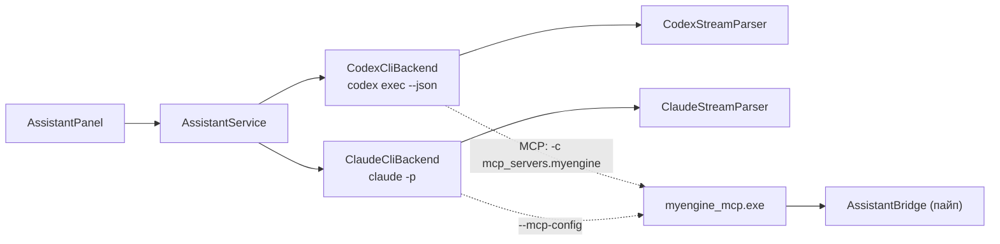

# AS4: выбор бэкенда ассистента (по умолчанию выключен) и Codex CLI

## Зачем это нужно

У разных людей в команде разные агенты: у одних Claude Code, у других OpenAI Codex. Поэтому ассистент больше не привязан к Claude и по умолчанию выключен:

- вкладка Assistant остаётся на месте (раскладка не прыгает), но пока ассистент не включён, в ней пустое состояние **Assistant is off** и кнопка **Enable...**; процессов `claude` и `codex`, моста `myengine_mcp.exe` и именованного пайпа в это время нет;
- выбор бэкенда хранится у пользователя, не в проекте: у разных людей разные CLI и разные пути к ним;
- рядом с `ClaudeCliBackend` появился `CodexCliBackend` поверх того же `IAssistantBackend` и того же MCP-моста.

## Как включить у себя

1. Установить CLI и один раз войти в него в терминале:
   - **Claude Code**: [инструкция](https://code.claude.com/docs/en/setup), затем `claude` и вход;
   - **Codex**: `npm install -g @openai/codex`, затем `codex login`.
2. В редакторе открыть вкладку **Assistant**, нажать **Enable...** и выбрать **Claude Code** или **Codex**. В меню рядом с названием написано, найден ли CLI (`found` или `not found`). Выбрать можно и ненайденный: панель покажет причину и поле для пути.
3. Выбор сохраняется сразу. Сменить или выключить: шапка чата → `...` → **Assistant Settings...** → список **Assistant** (Off / Claude Code / Codex). Выключение останавливает процесс и мост.

Уровень размышлений в шапке показывает **Effort: CLI default**, пока его не выбрали: тогда флаг `--effort` не передаётся и решает сам CLI (его настройка у пользователя, например `claude /effort` или `~/.codex/config.toml`, либо умолчание модели). Если CLI сообщит фактический уровень, он покажется как `Effort: High (CLI)`. Выбрать можно Low / Medium / High (у Claude ещё xhigh и max).

Если CLI стоит в нестандартном месте, путь задаётся в **Assistant Settings...** (поле CLI PATH) или переменной окружения: `MYENGINE_CLAUDE_PATH` или `MYENGINE_CODEX_PATH`.

## Где лежит настройка

`%APPDATA%\myengine\editor_settings.json`, ключ `assistant`. Другие ключи файла при записи не трогаются.

```json
{
  "assistant": {
    "backend": "none",
    "claudePath": "",
    "codexPath": "",
    "codexModel": ""
  }
}
```

| Поле | Значения |
| --- | --- |
| `backend` | `none` (по умолчанию, и если файла нет), `claude`, `codex` |
| `claudePath`, `codexPath` | Явный путь к CLI; пусто: поиск по `MYENGINE_*_PATH`, `PATH` и обычным папкам установки |
| `codexModel` | Модель новых чатов Codex; пусто: модель из `~/.codex/config.toml` |
| `allowExternalMcp` | `false` по умолчанию. `true`: мост к инструментам движка работает и при выключенном ассистенте, для внешних MCP-клиентов (ниже) |

Другой файл настроек (проверка, чистая установка) можно указать переменной `MYENGINE_ASSISTANT_SETTINGS`. Битый файл читается как «выключено» и пишет предупреждение в лог.

## Внешние MCP-клиенты: инструменты движка без панели

У движка уже есть MCP-сервер: `myengine_mcp.exe` (рядом с `myengine.exe`), stdio поверх именованного пайпа в редактор. Любой MCP-клиент, который пользователь запустил сам, может подключить его и пользоваться инструментами движка (`get_mode`, `list_entities`, `spawn_prefab` и остальные, список в [ai2-engine-tools.md](ai2-engine-tools.md)), пока редактор открыт. Своей панели для этого не нужно.

### Включение

1. В редакторе: вкладка **Assistant** → галочка **Allow external MCP clients** (в выключенном состоянии она под кнопкой Enable..., при включённом ассистенте она в **Assistant Settings...**). По умолчанию галочка снята: тогда моста нет совсем.
2. Редактор при включении пишет файл `%APPDATA%\myengine\mcp_endpoint.json` (имя пайпа и случайный токен этого запуска) и удаляет его при выходе. Клиентская конфигурация поэтому статическая: `myengine_mcp.exe` без аргументов читает этот файл при каждом подключении, перезапуск редактора ей не мешает. Другой файл: `--endpoint <файл>` или переменная `MYENGINE_MCP_ENDPOINT`.
3. Редактор должен быть открыт. Если его нет, клиент получает ошибку инструмента, а не падает.

### Подключение клиента

Путь к `myengine_mcp.exe`: `buildpp\<Config>\myengine_mcp.exe` рядом с редактором. Аргументов не нужно.

| Клиент | Как |
| --- | --- |
| Claude Code | `claude mcp add myengine -- "C:\путь\к\myengine_mcp.exe"`, либо в `.mcp.json` проекта: `{"mcpServers": {"myengine": {"command": "C:\путь\к\myengine_mcp.exe"}}}` |
| Codex | `~/.codex/config.toml`: `[mcp_servers.myengine]` и `command = 'C:\путь\к\myengine_mcp.exe'` (литеральная строка в одинарных кавычках: слэши не экранируются) |
| Любой другой MCP-клиент | stdio-сервер с этой командой, без аргументов и без переменных окружения |

Эти файлы конфигурации принадлежат пользователю: редактор их не трогает.

### Подтверждения

Ничего, что меняет сцену или файлы, не выполняется без карточки **Apply / Reject**. Вызов внешнего клиента ждёт решения внутри самого вызова (у клиента ограничен таймаутом инструмента: у Codex `tool_timeout_sec`, по умолчанию 60 с).

- Если панель Assistant открыта и включена, карточка в ней, как всегда.
- Если ассистент выключен или окно панели закрыто, карточка появляется **отдельным модальным окном редактора** («Assistant confirmation»).
- Чтение (`get_mode`, `list_entities`, ...) карточки не требует.
- Правки файлов внешнему клиенту доступны инструментами `edit_file` и `write_file`: те же папки (`assets/scripts/*.py`, `assets/prefabs/*.prefab.json`) и та же карточка с diff. Свои средства правки клиента (Edit у Claude Code, apply_patch у Codex) к редактору отношения не имеют.

### Ограничения

- Пайп принимает одного клиента одновременно. Если подключён один клиент (в том числе CLI встроенного ассистента на время хода), второй ждёт, пока первый отключится.
- Токен лежит в файле в `%APPDATA%` пользователя и в памяти редактора; пайп без токена соединение закрывает. Это защита от чужих процессов того же пользователя «по недосмотру», а не от того, кто уже запускает код от его имени.
- Два редактора одновременно: файл общий, значение записал тот, кто включил галочку последним.

## Как устроен Codex-бэкенд

Один процесс `codex exec --json` на ход. Сообщение идёт в stdin (`-`), ответ приходит JSON-строками в stdout. Продолжение диалога: `codex exec ... resume <thread id> -`.



Общее для бэкендов: `AssistantService`, `ChatStore`, мост, панель и запуск процесса с пайпами (`CliProcess`). У каждого бэкенда свой только разбор событий и сборка командной строки.

### Командная строка

```
codex exec --json --skip-git-repo-check --sandbox read-only -c approval_policy=never
           [--model <имя>] [-c model_reasoning_effort=<low|medium|high>]
           -c mcp_servers.myengine.command='<myengine_mcp.exe>'
           -c mcp_servers.myengine.args=['--pipe', '<имя пайпа>']
           -c mcp_servers.myengine.env={ MYENGINE_BRIDGE_TOKEN = '<токен>' }
           -c mcp_servers.myengine.startup_timeout_sec=30
           -c mcp_servers.myengine.tool_timeout_sec=900
           -c mcp_servers.myengine.default_tools_approval_mode='approve'
           [--image <файл>]... [resume <thread id>] -
```

- MCP-сервер `myengine` подключается ключами `-c` на один запуск. Файл `~/.codex/config.toml` пользователя не читается и не меняется, его настройки (модель, провайдер) продолжают действовать.
- Токен моста попадает в командную строку процесса Codex (видна только процессам того же пользователя), как в Claude-варианте он лежит в временном файле конфигурации.
- Первое сообщение разговора идёт с текстом `assets/assistant/system_prompt.md` и `system_prompt_codex.md` (у Codex нет флага «добавить к системному промпту»). При `resume` инструкции не повторяются.
- Картинки передаются флагом `--image`, остальные файлы перечисляются в тексте.

### Что можно ассистенту и чем это обеспечено

| Правило | Как держится у Claude Code | Как держится у Codex |
| --- | --- | --- |
| Правки только `assets/scripts/*.py` и `assets/prefabs/*.prefab.json` | Карточка на `Edit` / `Write` через `--permission-prompt-tool`, запрет вне папок | `--sandbox read-only`: сам Codex файлы не пишет. Правка идёт инструментами моста `edit_file` и `write_file`, те же папки и суффиксы |
| Подтверждение каждой правки с diff | Карточка Apply / Reject | Та же карточка: `edit_file` / `write_file` ждут решения пользователя внутри вызова |
| Подтверждение изменений сцены | Отдельный вызов `approve`, затем сам инструмент | Сам вызов инструмента ждёт карточку; `tool_timeout_sec=900`, чтобы не истечь, пока человек думает |
| Без shell и без сети | `--tools Read,Glob,Grep,Edit,Write`, deny на Bash и WebFetch | Sandbox read-only без сети: shell Codex остаётся, но может только читать |
| Без вопросов в неинтерактивном режиме | `--permission-mode` | `approval_policy=never`, плюс `default_tools_approval_mode='approve'` у сервера `myengine` (подтверждает сам мост) |

Ограничения, о которых стоит знать:

- shell у Codex отключить флагом нельзя; sandbox `read-only` оставляет ему чтение файлов проекта и любых путей диска, без записи и без сети. Это слабее, чем у Claude Code, где набор инструментов задан списком;
- встроенный `apply_patch` Codex в read-only sandbox отклоняется, поэтому системный промпт отправляет модель к `edit_file` / `write_file`;
- Codex не сообщает стоимость хода: в шапке и в футере показываются только токены;
- `max` из уровней effort Claude у Codex не существует: меню показывает Low / Medium / High, модель задаётся именем (поле в меню модели).

### История чатов

У Codex сессии лежат в `~/.codex/sessions` в формате, который он не документирует. Поэтому бэкенд сам складывает события каждого потока в `Saved/assistant/codex/<thread id>.jsonl`: строка `myengine.user` с сообщением пользователя, затем сырые события `codex exec --json` и строка `myengine.turn_end`. Открытие чата проигрывает файл тем же разбором, что и живой ход.

- Чаты обоих бэкендов видны в одном списке; во второй строке строки чата первым стоит `Claude` или `Codex`.
- Чат принадлежит CLI, который его начал: продолжить чат Claude в Codex (и наоборот) нельзя. Открыть и прочитать можно; при отправке панель скажет, какой бэкенд нужен.
- Индекс `Saved/assistant/chats.json` общий: свой заголовок, модель, effort, скрыт ли чат, бэкенд.

## Файлы

| Часть | Файл |
| --- | --- |
| Настройки | [AssistantSettings.h](../../engine/include/myengine/assistant/AssistantSettings.h), [AssistantSettings.cpp](../../engine/src/assistant/AssistantSettings.cpp) |
| Codex-бэкенд | [CodexCliBackend.h](../../engine/include/myengine/assistant/CodexCliBackend.h), [CodexCliBackend.cpp](../../engine/src/assistant/CodexCliBackend.cpp) |
| Разбор событий Codex | [CodexStreamParser.h](../../engine/include/myengine/assistant/CodexStreamParser.h), [CodexStreamParser.cpp](../../engine/src/assistant/CodexStreamParser.cpp) |
| Процесс CLI (общий) | [CliProcess.h](../../engine/src/assistant/CliProcess.h), [CliProcess.cpp](../../engine/src/assistant/CliProcess.cpp) |
| Мост: подтверждение в вызове, `edit_file` / `write_file` | [AssistantBridge.h](../../engine/include/myengine/assistant/AssistantBridge.h) (`confirmInCall`, `fileTools`, `offerApproveTool`) |
| Внешний клиент: файл конечной точки | [AssistantPanel.cpp](../../engine/src/ui/AssistantPanel.cpp) (`WriteEndpointFile`), [main.cpp](../../app/mcp_bridge/main.cpp) (`--endpoint`) |
| Панель: выключенное состояние, выбор бэкенда | [AssistantPanel.cpp](../../engine/src/ui/AssistantPanel.cpp) |
| Промпт Codex | [system_prompt_codex.md](../../assets/assistant/system_prompt_codex.md) |

## Как проверить

```powershell
ctest --test-dir build -C Debug -R assistant --output-on-failure
```

- `assistant_codex` (AS4): разбор событий по схеме `codex exec --json`, командная строка, поток на настоящих пайпах через заглушку `myengine_fake_codex`, resume, Stop, падение процесса, отказ turn.failed, история потоков, чат чужого CLI, файл настроек.
- `assistant_bridge`: добавлена проверка режима Codex (подтверждение в вызове, `edit_file`, `write_file`, отказы вне папок) и внешнего клиента (настоящий `myengine_mcp.exe` без `--pipe` находит редактор по файлу конечной точки, карточка не снимается, пока идёт чужой вызов, файл исчезает при выключении галочки).
- `assistant`: панель выключена по умолчанию, `SetBackend` включает и сохраняет выбор.

Вручную в окне редактора (прогнано): чистая установка без файла настроек показывает «Assistant is off» с кнопкой Enable...; меню показывает Claude Code `found`, Codex `not found`; выбор Codex без CLI показывает сообщение с командой установки и ссылкой Set path...; с заглушкой Codex (`MYENGINE_CODEX_PATH`) вопрос и ответ проходят, чат появляется в списке с пометкой Codex.

Внешний клиент (прогнано с настоящим `myengine_mcp.exe`): при включённой галочке и выключенном ассистенте клиент без аргументов получил ответы `initialize` и `get_mode`, на `spawn_prefab` редактор показал модальное окно «Assistant confirmation» с карточкой; при закрытии редактора вызов вернул ошибку «The editor closed the assistant bridge», файл `mcp_endpoint.json` удалён.

На настоящем Codex CLI бэкенд в этой ветке **не проверялся**: CLI на машине автора не установлен. Флаги и схема событий сверены по документации Codex (non-interactive mode, MCP, `exec_events.rs`); при расхождении у конкретной версии симптом виден в сообщении `Codex ended without an answer` с хвостом stderr.
