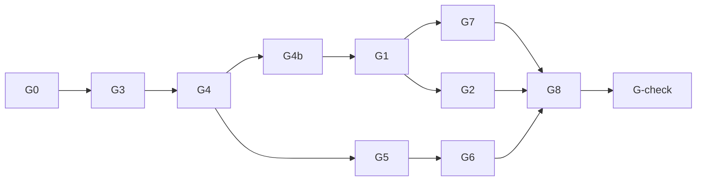

# Rocket League онлайн: архитектура

Документ написан до кода. Источники фактов: `assets/scripts/rocket_league.py`, `engine/src/ecs/systems/PhysicsSystem.cpp`, `engine/src/core/Application.cpp`, `engine/src/core/ProjectContext.cpp`, `CMakeLists.txt`; документация Jolt Physics (GitHub `jrouwe/JoltPhysics`, `Docs/Architecture.md`, `Build/CMakeLists.txt`, заголовки `Jolt/Physics`) и Steamworks (`partner.steamgames.com/doc`). Ссылки на код проверены по `main` `619120a` (ветка `game-rl-online`), чтение документации — 21.10.2026. Что в документации не нашлось, помечено «проверить» и закрывается задачей, которая этим пользуется.

## 1. Цель и решения

**Цель.** Игра «как Rocket League» по ощущениям (езда, прыжки, додж, воздух, стены и потолок, мяч), онлайн 1v1–4v4 с другом через Steam, отдельный билд «скинуть другу», ≥144 FPS в матче 4v4.

**Не цели (пока).** Выделенные серверы, матчмейкинг с незнакомцами, античит, реплеи, кастомизация машин, свой AppID в Steam.

**Решения Артёма (21.10).**

| Тема | Решение |
| --- | --- |
| Сеть | Через Steam: лобби, приглашения через оверлей, P2P через Steam Datagram Relay. Для теста AppID 480 (Spacewar), свой AppID не обязателен. SDK скачивает Артём сам (вход в partner.steamgames.com и согласие с условиями — только он) |
| Физика | Jolt Physics + свой контроллер машины в духе RL |
| Логика игры | C++ с фиксированным тиком и пересимуляцией; Python-версия уходит |
| Ветки | База `game-rl-online` от `main` `619120a`, задачи — `rl/<id>-<slug>`, в `main` — когда игра играется по сети |
| Порядок | G0 → G3 → G4 → G1 → G5 → G6 → G7 → G2 → G8 → G-check |

## Список определений

- **Тик** — один шаг симуляции матча, фиксированные 1/120 с; от FPS не зависит.
- **Хост** — игрок, на машине которого идёт авторитетная симуляция; он же владелец Steam-лобби.
- **Откат** — клиент восстанавливает мир на тик из снапшота хоста и пересчитывает свои вводы до текущего тика.
- **Снапшот** — состояние матча на тике, которое хост рассылает клиентам.
- **SDR** — Steam Datagram Relay: пакеты идут через сеть Valve, IP игроков не раскрываются.
- **Контроллер машины** — наш код, который каждый тик читает ввод и прикладывает к телу Jolt силы и моменты.

## 2. Как сейчас (по коду)

- **Вся игра — один скрипт.** `assets/scripts/rocket_league.py` (1074 строки): класс `Car` (`rocket_league.py:114`), поведение `RocketLeague` (`:459`) с режимами 1v1–4v4 (`_start_match`, `:564`), кик-оффом (`:588`), голами (`_check_goal`, `:920`), таймером и овертаймом (`OnUpdate`, `:497`), буст-падами (`_update_pads`, `:935`), ботами (`_assign_roles` `:805`, `_bot_input` `:825`), HUD через `me.hud` (`_update_hud`, `:626`) и камерой через `me.camera` (`_update_camera`, `:644`). Три темы арены (`ARENAS`, `:33`).
- **Физика движка — только OBB и сфера, без вращения.** `ColliderType` — `Box` и `Sphere` (`ColliderComponent.h:10`); пересечения `IntersectObbObb`, `IntersectSphereSphere`, `IntersectSphereObb` (`PhysicsSystem.cpp:412–611`). У `RigidbodyComponent` есть `velocity`, `acceleration`, `mass`, но нет угловой скорости, тензора инерции и моментов (`RigidbodyComponent.h:8–19`). Шаг 1/60 с (`PhysicsWorldState.h:55`) с аккумулятором: не больше 8 шагов за кадр, не мельче 1/240 с (`PhysicsSystem.cpp:820–827`).
- **Порядок пар не гарантирован.** Широкая фаза `UniformGrid3D` хранит ячейки в `std::unordered_map`, уникальность пар — в `std::unordered_set` (`UniformGrid3D.h:49`, `:102`); `PhysicsSystem.cpp:887` ещё держит `unordered_map<EntityId, size_t>`.
- **Машина — один OBB, поведение пишет скрипт.** `Car.drive` (`:183`) каждый кадр перезаписывает скорость и поворот; прыжок, двойной прыжок, додж, выравнивание на земле — скриптовые анимации и пороги. Приземление «на колёса/бок/крышу» — `land()` (`:300`) и `upset()` (`:323`) с таймерами и порогами `TILT_OK`, `TILT_ROOF`, `FALL_TIME` (`:81–87`). Удары по мячу — скриптовые импульсы поверх контакта (`_car_ball_hits`, `:744`), демолиш — `_demolish` (`:792`, порог скорости `DEMO_SPEED = 26`, `:49`).
- **Мяч и потолок — заплатки.** Мяч режется по скорости 42 м/с (`:906`) и «отскакивает» от высоты `WALL_TOP` кодом (`:909`); вращение мяча рисуется из скорости (`:915`), физического спина нет. Для машин то же самое: «there is no ceiling collider» (`:709`), положение зажимается по высоте.
- **Арена из боксов.** `_build_arena` (`:1013`): пол, стены невидимыми коллайдерами до высоты 10 м плюс видимый блок без коллизии (`_wall`, `:1008`), углы — плоские стенки под 45°. Потолка, рамп и езды по стенам нет. Поле 40 × 60 м, ворота 12 × 5 × 5 м, мяч r = 1.4 м (`:8–11`) — масштаб не RL.
- **Вид.** Растянутые кубы (`assets/models/rl_box.obj`), один направленный свет без теней.
- **Скрипты тикают с переменным dt.** `Application::Run` берёт `timer_.DeltaTime()` и вызывает `world_.UpdateSystems(deltaTime)` (`Application.cpp:667–673`), `ScriptSystem::UpdateInstances` — `OnUpdate(deltaTime)` (`ScriptSystem.cpp:796`); сам скрипт режет `dt` до 0.05 (`rocket_league.py:498`). Результат зависит от FPS и не воспроизводим.
- **Сети нет.** **Exe всегда открывает редактор:** `Application.cpp:343` собирает `SceneEditorServices`, `:475` вызывает `uiManager_.Initialize(...)`; HUD — строки `me.hud`, которые редактор показывает во вьюпорте (`:440–450`).
- **Упаковки нет.** `MYENGINE_SOURCE_DIR` зашит и в корень проекта (`ProjectContext.cpp:179`), и в поиск конфига и шейдеров (`main.cpp:200`, `:235`), в `ResourceManager.cpp:1441`, `Dx12RenderAdapter.cpp:112`: exe на машине разработчика читает исходники.

## 3. Модули

```
game/rl/                     библиотека myengine_rl (C++17, без рендера и окна)
  RlTuning.{h,cpp}           константы из data/rl_tuning.json
  RlArena.{h,cpp}            процедурный меш арены (коллизия + рендер)
  RlSim.{h,cpp}              мир на Jolt: машины, мяч, тик, SaveState/RestoreState
  RlCarController.{h,cpp}    подвеска, сцепление, прыжки, додж, воздух, буст
  RlMatch.{h,cpp}            правила: кик-офф, голы, таймер, овертайм, пады, демолиш
  RlBots.{h,cpp}             боты (порт ролей и эвристик из Python), выдают RlInput
  RlNet*.{h,cpp}             протокол, хост/клиент, предсказание и откат
engine/…/net/                транспорт: INetTransport, LoopbackTransport, UdpTransport, SteamTransport
engine/…/game/RlGameSystem   мост в ECS: сущности-меши, интерполяция, камера, HUD, ввод
```

- `myengine_rl` не знает про DX12, ImGui и ECS: его гоняют без окна в тестах и пересимулируют при откате.
- Python-версия (`rocket_league.py`, префабы `rl_*`) удаляется, когда C++-версия догонит её по функциям (конец G4).
- Jolt — сабмодуль `external/JoltPhysics`, Steamworks SDK — снаружи репозитория (раздел 7.5); `myengine_rl` зависит только от Jolt.

## 4. Симуляция

- **Фиксированный тик 120 Гц**, `RlSim::Step(const RlInput inputs[])`. Рендер не влияет на результат; кадр рисует состояние, интерполированное между двумя последними тиками (`alpha`). Движковый `PhysicsSystem` (60 Гц, OBB) в матче не участвует: RL-мир живёт отдельно в `myengine_rl`.
- **Состояние** `RlWorldState`: машины (поза, скорости, буст, флаги прыжка/доджа, таймеры), мяч, пады, матч (счёт, время, фаза). Состояние вне Jolt — плоская структура без указателей, копируется `memcpy`; Jolt-часть — `PhysicsSystem::SaveState` / `RestoreState` (раздел 5.3).
- **Детерминизм:** один бинарник у всех игроков; Jolt собирается с `CROSS_PLATFORM_DETERMINISTIC` (раздел 5.2); свой код — без итерации по `unordered_*` в симуляции, свой ГПСЧ с сидом матча, фиксированный порядок машин по слотам, без `/fp:fast` (флага `/fp` у нас нет, у MSVC по умолчанию `/fp:precise`, `cmake/CompilerOptions.cmake`) и без `std::sort`/`std::hash` на путях симуляции (документация Jolt: их реализации различаются между платформами). Детерминизм не обязателен для корректности (хост авторитетен), но уменьшает поправки клиента.
- **Масштаб и константы:** метры = uu/100. Источник — Unreal Units по RLBot wiki (`github.com/RLBot/RLBot/wiki/Useful-Game-Values`, `…/Jumping-Physics`). Не официальные данные Psyonix: сверять с игрой при тюнинге в G3.

| Величина | Значение | Проверено |
| --- | --- | --- |
| Гравитация | 6.5 м/с² (650 uu/с²) | RLBot wiki, `world_gravity_z = -650` |
| Макс. скорость машины / без буста / сверхзвук | 23 / 14.1 / 22 м/с | RLBot wiki |
| Ускорение буста | 9.92 м/с² на земле, 10.58 в воздухе; расход 33.3/с | RLBot wiki |
| Прыжок | импульс 2.92 м/с и до 2.92 м/с за 0.2 с удержания | RLBot wiki |
| Окно второго прыжка/доджа | 1.25–1.45 с | RLBot wiki |
| Мяч | r = **0.9275 м** (92.75 uu), макс. 60 м/с, упругость 0.6, масса 30 (машина 180) | RLBot wiki |
| Макс. угловая скорость машины | 5.5 рад/с | RLBot wiki |
| Арена | стены x = ±40.96, y = ±51.20 м, потолок 20.44 м, скошенные углы | RLBot wiki |
| Ворота | высота 6.43 м, ширина 17.86 м (центр-штанга 8.93 м), глубина 8.8 м | RLBot wiki |
| Хитбокс Octane | 1.18 × 0.84 × 0.36 м | по памяти (в RLBot wiki нет), проверить |
| Доджевый импульс, отмена доджа | — | в RLBot wiki на этих страницах нет, проверить |

Все значения лежат в `rl_tuning.json`.

## 5. Физика (Jolt + свой контроллер)

### 5.1 Что берём от Jolt

- **Версия:** последний релиз `v5.6.0` (11.07.2026, MIT, `project(JoltPhysics VERSION 5.6.0 LANGUAGES CXX)`); берём тег `v5.6.0`, обновление — отдельной задачей.
- **Мир:** статический `MeshShape` арены, мяч — динамическая сфера, машина — динамический бокс-хитбокс с инерцией, массы по таблице выше.
- **Арена-меш.** `MeshShapeSettings(VertexList, IndexedTriangleList)`; по `MeshShape.h` треугольники идут **против часовой стрелки** и **односторонние**: нормали арены смотрят внутрь, иначе мяч и машины провалятся. Пороговый угол активных рёбер `mActiveEdgeCosThresholdAngle` по умолчанию cos 5°: меньше — «призрачные» столкновения на стыках треугольников, больше — артефакты выталкивания; проверяем на рампах и стыках стен. Меш не умеет считать массу — он статический, массу не берёт. Подробнее про меши в документации Jolt: «mostly used for static geometry».
- **От тоннелирования** быстрые тела (мяч 60 м/с, машины 23 м/с) переводим в режим `EMotionQuality::LinearCast` — проверить в G3. Прикидка: мяч за тик 1/120 с проходит 0.5 м при r = 0.93 м, то есть запас есть и без него, но односторонний меш этой защиты не заменяет.
- **Не используем** готовый `VehicleConstraint` (`Jolt/Physics/Vehicle/`: колёсный и гусеничный контроллеры, мотор, коробка, дифференциал): он моделирует реальную машину, RL-ощущения — аркадные. Но подвеску лучами и `VehicleCollisionTester` можно подсмотреть для своего контроллера.
- **Контактные события.** По документации, порядок колбэков `ContactListener` из потоков Jolt недетерминирован. События ударов собираются в список и применяются после `Update` в порядке (пара тел, номер события); то же с `PhysicsSystem::GetActiveBodies` — в симуляции его порядок не используем.

### 5.2 Сборка в CMake

Подключаем как сабмодуль `external/JoltPhysics` (тег `v5.6.0`) рядом с `freetype` и `tracy` (`CMakeLists.txt:39`, `:167`). Дерево Jolt — `Build/CMakeLists.txt`, библиотека — цель `Jolt` (исходники подключает `Jolt/Jolt.cmake`); `Build/CMakeLists.txt` разрешено подключать как подпроект — основная библиотека собирается, а `UnitTests`, `HelloWorld`, `PerformanceTest`, `Samples`, `JoltViewer` — только когда файл корневой (`CMAKE_CURRENT_SOURCE_DIR STREQUAL CMAKE_SOURCE_DIR`). Минимум CMake 3.20 (у нас 3.24, `CMakeLists.txt:1`), C++17 у нас уже стоит (`CMakeLists.txt:17`); из рекомендованных Jolt сред для Windows указан Visual Studio 2026 — как у нас.

```cmake
# как будет в корневом CMakeLists.txt (G3)
set(CROSS_PLATFORM_DETERMINISTIC ON CACHE BOOL "" FORCE)
set(USE_STATIC_MSVC_RUNTIME_LIBRARY OFF CACHE BOOL "" FORCE)  # у нас динамический CRT (/MD), по умолчанию Jolt берёт статический
set(ENABLE_ALL_WARNINGS OFF CACHE BOOL "" FORCE)              # по умолчанию /Wall /WX
set(INTERPROCEDURAL_OPTIMIZATION OFF CACHE BOOL "" FORCE)
set(CPP_EXCEPTIONS_ENABLED ON CACHE BOOL "" FORCE)            # у нас /EHsc и RTTI
set(CPP_RTTI_ENABLED ON CACHE BOOL "" FORCE)
add_subdirectory(external/JoltPhysics/Build EXCLUDE_FROM_ALL)
target_link_libraries(myengine_rl PUBLIC Jolt)
```

Что из этого проверено по `Build/CMakeLists.txt`, а что остаётся на G3:

| Опция | Значение по умолчанию | Что делаем |
| --- | --- | --- |
| `CROSS_PLATFORM_DETERMINISTIC` | OFF | ON: в MSVC `/fp:precise` вместо `/fp:fast`, на других компиляторах `-ffp-contract=off`; Jolt становится примерно на 8% медленнее (документация). Определение для кода — `JPH_CROSS_PLATFORM_DETERMINISTIC` (само выставляется) |
| `USE_STATIC_MSVC_RUNTIME_LIBRARY` | ON при MSVC | OFF: у нас `CMAKE_MSVC_RUNTIME_LIBRARY` не задан (динамический CRT); смесь `/MT` и `/MD` ломает линковку |
| `ENABLE_ALL_WARNINGS` | ON (`/Wall /WX`) | OFF, чтобы сборка Jolt не падала на предупреждениях нового MSVC; наши `/W4` — на цели `myengine_rl` |
| `INTERPROCEDURAL_OPTIMIZATION` | ON | OFF, пока не измерено, что LTO нужна: у нашего кода `/GL` не включён (`cmake/CompilerOptions.cmake:34–47`) |
| `CPP_EXCEPTIONS_ENABLED`, `CPP_RTTI_ENABLED` | OFF | ON, чтобы флаги совпадали с нашими (`/EHsc` — `CompilerOptions.cmake:40`, RTTI не отключён); если `RegisterTypes` ругнётся на несовпадение — выровнять |
| `DOUBLE_PRECISION`, `OBJECT_LAYER_BITS` | OFF, 16 | оставить (арена ±51 м, слоёв 2–3) |
| `USE_AVX2`, `USE_FMADD`, `USE_SSE4_*` | ON | Остаётся AVX2: exe не запустится на CPU без AVX2 (у друга почти наверняка есть, но **проверить**). FMA при `CROSS_PLATFORM_DETERMINISTIC` отключается через `-ffp-contract=off` для GCC/Clang; для MSVC поведение проверить в G3 |
| `TARGET_*`, `JPH_BUILD_SHARED_LIBS` | ON / `BUILD_SHARED_LIBS` | подпроект их не строит; статическая библиотека |

Предупреждение документации: **приложение обязано компилироваться с теми же `JPH_*`-определениями, что и библиотека** (`RegisterTypes` сверяет и при несовпадении пишет в `Trace` и вызывает `std::abort`); `target_link_libraries(... Jolt)` передаёт определения сам, копировать руками не нужно. Заголовки Jolt подключаем как `SYSTEM` (как остальные `external/`, `CMakeLists.txt:160`), чтобы `/W4` не трогал их. Инициализация: `JPH::RegisterDefaultAllocator()`, `Factory`, `RegisterTypes()`, `TempAllocatorImpl`, `JobSystem`; решение «`JobSystemThreadPool` или `JobSystemWithBarrier` поверх нашего `jobs::`» — в G3 по замеру тика 8 машин.

### 5.3 Детерминизм, `SaveState`, `RestoreState`

Что говорит документация Jolt (`Docs/Architecture.md`, раздел «Deterministic Simulation», «Rolling back a simulation»; `PhysicsSystem.h`, `StateRecorder.h`):

- Симуляция детерминирована, если **один и тот же бинарник** и все изменяющие мир вызовы идут в **одном порядке** (добавление, удаление и изменение тел и ограничений). Кросс-платформенный детерминизм включается опцией выше и «менее проверен, чем остальное».
- Запросы широкой фазы не детерминированы; порядок результатов узкой фазы и колбэков — тоже.
- Сигнатуры: `void PhysicsSystem::SaveState(StateRecorder&, EStateRecorderState = All, const StateRecorderFilter* = nullptr) const` и `bool PhysicsSystem::RestoreState(StateRecorder&, const StateRecorderFilter* = nullptr)`. `EStateRecorderState`: `Global`, `Bodies`, `Contacts`, `Constraints`, `All`. `StateRecorderFilter` умеет отсеять тела, ограничения и контакты (`ShouldSaveBody`, …).
- Откат: сохраняем состояние каждый тик и вызываем `RestoreState` со снимком тика N. **Сохраняется только то, что физика меняет в `Update`**; настройки вроде трения и упругости надо выставлять одинаково самим.
- **Добавление и удаление тел в откатываемых тиках создаёт проблемы**, а `BodyID` у хоста и клиента должны совпадать (при расхождении порядка вызовов снапшоты не сходятся). Документация советует вместо уничтожения удалять и добавлять заново или использовать `BodyInterface::CreateBodyWithID`.

Выводы для нашего устройства:

1. Все тела матча (8 машин, мяч, арена) создаются при старте матча в одном порядке и **живут до конца**; демолиш и респаун реализуются как состояние (слой без коллизий + позиция «за ареной»), а не добавлением и удалением тела.
2. Кольцевой буфер снимков на 128 тиков (~1 с); каждый тик пишет в плоский буфер, а не в `std::stringstream` (готовый рекордер Jolt — на потоках, аллокации).
3. `RestoreState` проверяется тестом G3 (раздел 10): сохранить, прокрутить N тиков, восстановить, прокрутить те же вводы — побайтово то же состояние. Режим `StateRecorder::SetValidating` (документация: сверка состояния при шаге после восстановления) годится для отладки расхождений.

## 6. Матч и боты

- `RlMatch`: режимы 1v1–4v4, кик-офф (позиции RL), гол (зона за линией ворот), таймер 5 мин, овертайм, буст-пады (большие 100 / 10 с, малые 12 / 4 с), демолиш и респаун.
- `RlBots`: порт текущих эвристик Python (роли каждые 0.3 с — `rocket_league.py:681`, прогноз мяча, пады, прыжки и доджи) на `RlSim`; выдают тот же `RlInput`, что игрок.
- Контроллер машины, на каждый тик:
  - 4 луча-подвески от точек колёс вдоль «вниз» машины: пружина и демпфер, контакт определяет «на земле» по любой поверхности (пол, рампа, стена, потолок);
  - сцепление: боковое трение колёс и «прилипание» к поверхности (езда по стенам и потолку);
  - газ, тормоз, руль, дрифт как силы и моменты;
  - прыжок — импульс по нормали машины и удержание; двойной прыжок; додж — импульс и угловая скорость по направлению стика, отмена вертикальной скорости;
  - воздух: моменты pitch/yaw/roll с демпфированием, свободный air roll; буст — сила вдоль носа машины;
  - **приземление — физикой**: машина садится как упала; без скриптовых `land()` / `upset()` и выравнивания. Машина на крыше и неподвижная — RL-механика «перевернуться» (прыжок с крыши даёт момент на переворот).
- Мяч ↔ машина: контакт Jolt + RL-добавка импульса удара (зависит от относительной скорости и точки удара). Машина ↔ машина: контакт Jolt + демолиш на сверхзвуке.

## 7. Сеть

### 7.1 Модель

Хост — игрок (listen server), авторитетный. Клиенты шлют ввод, хост шлёт снапшоты.

**Клиент — полный откат и пересимуляция (как в RL).** Клиент живёт «впереди» хоста на RTT/2 + буфер; получив снапшот тика T, восстанавливает мир на T, применяет свои сохранённые вводы и прогнозные вводы чужих (последний известный) до текущего тика. Видимые рывки сглаживаются: ошибка позиции и поворота гаснет за 0.1–0.2 с.

### 7.2 Сообщения и бюджет

| Сообщение | Направление | Надёжность | Частота | Содержание |
| --- | --- | --- | --- | --- |
| `Input` | клиент → хост | ненадёжно | каждый тик (120 Гц), с избыточностью последних 8 тиков | 6 байт на тик: газ, руль, pitch, yaw, roll, кнопки (прыжок, буст, ручник) |
| `Snapshot` | хост → клиенты | ненадёжно | 60 Гц | тик, подтверждённый тик ввода, фаза, счёт, время, мяч, машины, пады битмаской |
| `Event` | хост → клиенты | надёжно | по событию | гол, демолиш, начало и конец матча, вход и выход игрока |
| `Join` / `Welcome` | клиент ↔ хост | надёжно | при входе | слот, команда, сид, тюнинг |

Ориентировочные размеры с квантованием (позиции 16 бит при шаге ~1.6 мм, скорости 16 бит, кватернион «smallest three» 32 бита): машина ≈ 30 байт, мяч ≈ 22, 34 пада — 5 байт; **снапшот 4v4 ≈ 300 байт, `Input` ≈ 56 байт** (8 тиков × 6 + заголовок): около 18 кБ/с в одну сторону на клиента для снапшотов и 7 кБ/с для ввода.

**Все ненадёжные сообщения держим меньше одного пакета.** По документации Steam, ненадёжное сообщение может быть больше MTU, но повторной передачи нет — потеря любого фрагмента теряет всё сообщение. Размер пакета в SDK — константа `k_cbSteamNetworkingSocketsMaxUDPMsgLen` (порядка 1.2–1.3 КБ — проверить при интеграции); бюджет `Snapshot` и `Input` — ≤ 1100 байт.

### 7.3 Транспорт

```
INetTransport { Send(peer, data, reliable), Poll() }
  LoopbackTransport   тесты в одном процессе (задержка и потери — параметры)
  UdpTransport        два окна на одном ПК и LAN, ключи --net-sim latency/jitter/loss
  SteamTransport      ISteamNetworkingMessages (P2P через Steam Datagram Relay)
```

### 7.4 Steam (по документации Steamworks)

**Какой API.** `ISteamNetworkingMessages` — сообщения «как UDP»: без дескрипторов соединений, сессии создаются неявно, поддержаны надёжные и ненадёжные, фрагментация и сборка. Под капотом — соединения `ISteamNetworkingSockets` («сессии»); если понадобится управление и обработка отказов, документация рекомендует `ISteamNetworkingSockets`. Старый `ISteamNetworking` объявлен устаревшим. P2P-пакеты **автоматически идут через сеть Valve (SDR)**, когда это уместно, при этом «прямое соединение может быть установлено» — IP игроков не раскрываются.

**Сессия.**

- Идентификатор пира — `SteamNetworkingIdentity` (`SetSteamID64(...)`; `GetSteamID64()` возвращает 0, если идентичность не Steam ID).
- `SendMessageToUser(identity, data, size, flags, remoteChannel)` создаёт сессию, если её нет. **Колбэка об успехе нет**, поэтому первое сообщение клиента — `Join` с ответом `Welcome` (раздел 7.2).
- Если пир пишет первым, приходит `SteamNetworkingMessagesSessionRequest_t` с `m_identityRemote`; до `AcceptSessionWithUser(identity)` сообщения не доставляются. Хост принимает сессии только от участников своего лобби.
- Отказ рукопожатия и аномалии — `SteamNetworkingMessagesSessionFailed_t`; закрытие пиром и тайм-аут простоя колбэком не сообщаются, состояние спрашивается `GetSessionConnectionInfo`.
- Приём — `ReceiveMessagesOnChannel(channel, messages, max)`, каждое сообщение освобождается `Release()`. Надёжные сообщения одного пира в одном канале приходят ровно один раз и по порядку; ненадёжные могут теряться, дублироваться и меняться местами; между каналами порядка нет. Каналы нумеруются: 0 — управление и события (надёжно), 1 — ввод, 2 — снапшоты.
- Флаги отправки: `k_nSteamNetworkingSend_Unreliable` (=0), `Reliable` (=8), `NoNagle`, `NoDelay`; для ввода и снапшотов берём `UnreliableNoNagle` (документация описывает как «отправить ненадёжно без алгоритма Нейгла»), для событий — `Reliable`. `k_nSteamNetworkingSend_AutoRestartBrokenSession` — без него отправка в сломанную сессию возвращает `k_EResultNoConnection`, с ним начинается новая. Максимальное сообщение — `k_cbMaxSteamNetworkingSocketsMessageSizeSend = 512 КиБ`.
- Сеть Valve инициализируется лениво; чтобы не ждать при первом сообщении, в запуске вызываем `ISteamNetworkingUtils::InitRelayNetworkAccess()` и следим за `SteamRelayNetworkStatus_t`; по документации «обычно это занимает несколько секунд».

**AppID 480 и запуск.**

- `SteamAPI_Init()` обязан вернуть успех до любого вызова Steamworks. Неудача — если не запущен клиент Steam, не определён AppID, различается пользователь ОС (например, один процесс от администратора, другой нет), приложением не владеют, AppID не настроен полностью. Работающий клиент Steam обязателен у **обоих** игроков.
- Вне клиента Steam AppID берётся из `steam_appid.txt` рядом с exe (в текущем каталоге) — одна строка `480`. Документация: файл «не нужно» отгружать в релизных билдах; для билда «скинуть другу» с 480 он нужен.
- **`SteamAPI_RestartAppIfNecessary` для AppID 480 не вызываем.** Документация: функция перезапускает приложение через Steam, если оно запущено не из Steam; с 480 это запустило бы Spacewar, а не нашу игру. (Вывод из описания функции, проверить в G6.)
- `SteamAPI_RunCallbacks()` — раз в кадр в главном потоке (документация: «большинство игр раз в кадр, не реже раза в секунду»); `SteamAPI_Shutdown()` на выходе.
- AppID 480 — общедоступное тестовое приложение Valve (пример SpaceWar в SDK). Сообщество считает его использование «серой зоной»: не для выпуска, игроки видят «Spacewar». Для личного теста с другом подходит. **Проверено в G6b на одном аккаунте (SDK 1.65):** `SteamAPI_Init` с `steam_appid.txt`=480 проходит за ~0,3 с, лобби «только для друзей» создаётся (~0,35 с), данные лобби и участника читаются и меняются, сеть Valve выходит в `Current` за 6–8 с, лобби закрывается, `SteamAPI_Shutdown` и повторный `SteamAPI_Init` работают (подробно в [steam-setup.md](steam-setup.md), раздел 6). **Не проверено:** соединение двух аккаунтов (`ISteamNetworkingMessages` с настоящим пиром, ping, оверлей) — нужен второй аккаунт-друг. Лобби не делаем публичными: с 480 пользуются многие, лобби строго приватное и по приглашению.

**Лобби и приглашения (`ISteamMatchmaking`, `ISteamFriends`).**

- Хост: `CreateLobby` → `LobbyCreated_t` (call result). После создания владелец ставит данные лобби `SetLobbyData` (режим, `host_id`, версия билда): «только владелец лобби меняет данные лобби». Лобби вмещает до 250 участников (документация), нам нужно 8.
- Приглашение: оверлей — `ISteamFriends::ActivateGameOverlayInviteDialog(lobbyID)`; либо `ISteamMatchmaking::InviteUserToLobby` присылает другу сообщение в чате со ссылкой «присоединиться».
- Вход друга: если игра запущена — колбэк `GameLobbyJoinRequested_t` с ID лобби (игра сама решает принять ли); если нет — Steam запускает exe с командной строкой `+connect_lobby <64-битный ID>`, значит `--game` разбирает этот ключ; приложение реализует `ISteamApps::GetLaunchCommandLine`, чтобы подавить предупреждение. Затем `JoinLobby` → `LobbyEnter_t`.
- Участники: `LobbyChatUpdate_t` при входе и выходе. «Один и только один владелец лобби» — хост матча; при выходе владельца владение переходит, поэтому хост фиксируется в `host_id` на старте и выход хоста завершает матч у всех.
- Работа оверлея в DX12-окне нашего движка — **не проверено** (проверка G6b без окна; приглашения без оверлея идут через список друзей Steam).
- **Список лобби.** Лобби «только для друзей» **не возвращается** `RequestLobbyList` (заголовок SDK: `k_ELobbyTypeFriendsOnly` — «not in public lobby list»; подтверждено на практике в G6b: своё лобби в поиске не найдено). Друзья находят его по присутствию: `ISteamFriends::GetFriendGamePlayed` → `FriendGameInfo_t::m_steamIDLobby` (для игры 480), затем `RequestLobbyData` и фильтр `rl_game=1`; присутствие обновляется за 1–3 с.

### 7.5 Что нужно в билде и репозитории

- **SDK** (`steamworks_sdk_*.zip` с partner.steamgames.com) скачивает Артём. В репозиторий его не кладём: путь задаёт переменная CMake `STEAMWORKS_SDK_DIR`, опция `MYENGINE_STEAM` (OFF — сборка без Steam, офлайн и UDP). Лицензионные условия SDK на распространение — **подтвердить с Артёмом** перед тем как что-либо из SDK попадёт в `dist/` кроме `steam_api64.dll`.
- **В папку билда:** `steam_api64.dll` (из `redistributable_bin/win64` SDK, рядом с exe), `steam_appid.txt` (`480`), остальное — раздел 8. Линковка — `steam_api64.lib`. С `MYENGINE_STEAM=ON` это нужно каждому exe, который использует `myengine_rl` (CMake копирует сам: `myengine_rl_steam_runtime`).
- Без запущенного Steam игра работает офлайн с ботами и по UDP.

## 8. Игровой режим и упаковка

- Режим игры без редактора (`--game` или отдельная цель `RocketLeague.exe`): окно или полный экран, меню (с ботами / создать лобби / пригласить / настройки), HUD (счёт, время, буст-кольцо, сообщения), ввод XInput + клавиатура, камера (ball cam / свободная). Сейчас exe всегда поднимает редактор (раздел 2), это отдельная задача G1.
- Shipping-сборка: без `MYENGINE_SOURCE_DIR`, без ассистента и MCP; логи и настройки в `%LOCALAPPDATA%\RocketArena` (сделано в G2, см. [packaging.md](packaging.md)).
- `tools/package_game.ps1` → `dist/RocketArena/`: exe, нужные ассеты и шейдеры (HLSL компилируется при запуске `D3DCompile`, значит исходники шейдеров и `d3dcompiler_47.dll` нужны), `steam_api64.dll`, `steam_appid.txt`, CRT app-local (каталог `Microsoft.VC*.CRT` из `VC\Redist\MSVC\<версия>\x64`), zip. Проверка — запуск из чистой папки на машине без репозитория и без Visual Studio.

## 9. Графика и производительность

- Меши вместо кубов: машина (низкополигональный «Octane» из генератора), мяч, арена с рампами, ворота с сеткой, трибуны.
- Тени от направленного света (shadow map), блик и френель, след мяча и буста, частицы инстансингом.
- Бюджет: тик симуляции ≤ 0.3 мс для 8 машин; откат 20 тиков ≤ 6 мс в худшем случае; кадр 4v4 онлайн ≤ 7 мс (≥ 144 FPS). Ограничитель FPS и VSync в настройках.

## 10. Проверка

- **Тесты без окна** (`myengine_rl`, ctest): машина едет, тормозит, поворачивает; прыжок, двойной, додж дают ожидаемые высоты и скорости; приземление на колёса после доджа; езда по стене и потолку; мяч отскакивает с нужной упругостью (0.6); гол засчитывается; одинаковые вводы → одинаковое состояние; `SaveState` / `RestoreState` → то же состояние через N тиков.
- **Сеть:** loopback-тест хост + клиент с задержкой 100 мс и потерями 5%: расхождение после сходимости ≈ 0; два окна по UDP; затем Steam с другом (две машины, два аккаунта).
- **Профиль:** Tracy-зоны `Rl::Step`, `Rl::Rollback`, `Rl::Net`; замеры по методике `docs/measurements/lab1/README.md`.

## 11. Риски и открытые вопросы

| Риск | Как закрываем |
| --- | --- |
| Тест на AppID 480 (лобби, SDR, оверлей в DX12) не описан в документации | Первая половина G6: два аккаунта, результат записать в этот документ |
| Расхождение симуляции у разных CPU (AVX2, FMA) | `CROSS_PLATFORM_DETERMINISTIC`, один бинарник, сравнение хешей состояния в тесте G5/G6 |
| `MeshShape` односторонний: тоннелирование или «призрачные» рёбра на рампах | `LinearCast` для мяча и машин, проверка стыков в тесте арены (G3) |
| Не проверены Octane-хитбокс, импульс доджа | Сверить с игрой и RLBot (`Jumping-Physics`, таблица HalfwayDead) в G3 |
| Лицензия Steamworks SDK и содержимое `dist/` | Согласовать с Артёмом до G6 |
| Бюджет FPS 4v4 (откат до 20 тиков) | Профиль Tracy в G8; при нехватке — снизить частоту хоста до 30 Гц или тик до 90 Гц |

## 12. План задач

A — Артём; задачи берёт core. Ветки — `rl/<id>-<slug>` от `game-rl-online`, PR обратно в неё; в `main` — когда игра играется по сети. Порядок (решение Артёма 22.10): G0 ✓ → G3 ✓ → G4 ✓ → **G4b → G1 → G7** → G5 → G6 → G2 → G8 → G-check. G4b стоит перед G1, потому что меню настроек и экран игры строятся на уже исправленных управлении, камере и ощущении машины; G7 — после G1, потому что HUD и меню рисует игровой режим.

| # | Задача | Зависит |
| --- | --- | --- |
| **G0** ✓ | Этот документ | — |
| **G3** ✓ | Физика RL на Jolt: сабмодуль, арена-меш, мяч со спином, машина с подвеской, прыжки, додж, воздух, приземление, буст, демолиш; тесты без окна | G0 |
| **G4** ✓ | Матч на C++: режимы 1v1–4v4, кик-офф, голы, таймер, овертайм, пады, боты | G3 |
| **G4b** | Полировка геймплея по фидбеку Артёма: управление как в RL и данные для переназначения (`rl_controls.json`), вес машины и приземление без «неваляшки», переворот с крыши и бока прыжком, камера как в RL (не выходит за арену), боты чуть умнее — [rl-physics.md](rl-physics.md), [rl-match.md](rl-match.md) | G4 |
| **G1** | Игровой режим без редактора: окно, фиксированный тик 120 Гц, интерполяция, меню и HUD в стиле RL (главный экран, выбор режима, настройки с переназначением клавиш, камеры, графики, звука; табло, буст-кольцо, отсчёт, итоговая таблица), XInput | G4b |
| **G7** | Графика и атмосфера: меши машины, мяча и арены, трибуны с болельщиками, тени, блики, частицы, взрыв гола и повтор, свечение падов, звук | G1 |
| **G5** | Неткод на локальном UDP: ввод, снапшоты, предсказание и откат, `--net-sim`, два окна | G4 |
| **G6** | Steam: SDK, лобби, приглашения, P2P-транспорт, игра с другом | G5, SDK от Артёма |
| **G2** | Упаковка: shipping-сборка, `package_game.ps1`, zip, проверка на чистой машине | G1 |
| **G8** | Производительность и полировка: профиль 4v4 онлайн, цель ≥ 144 FPS, настройки | всё |
| **G-check** | Общий проход проверок и сборка билда «скинуть другу» | всё |



Перед стартом: свободное место на C: (Jolt и сборка требуют 10–15 ГБ); Steamworks SDK к G6.
