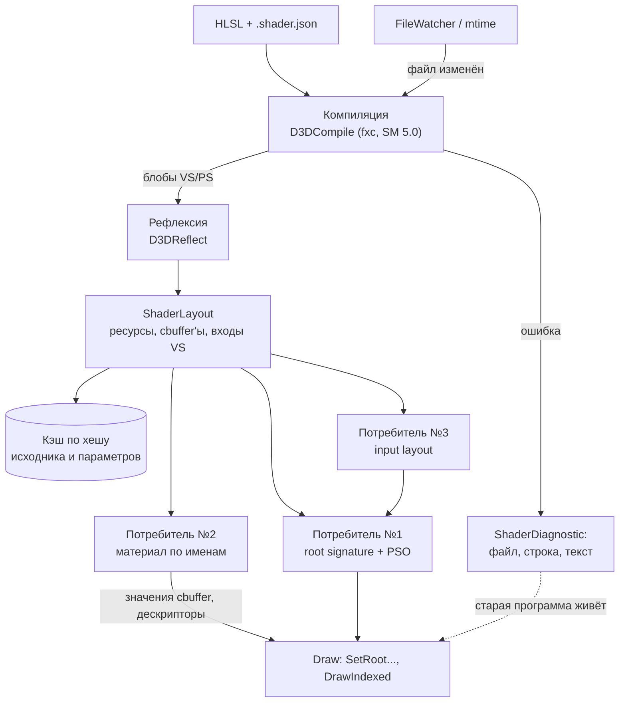
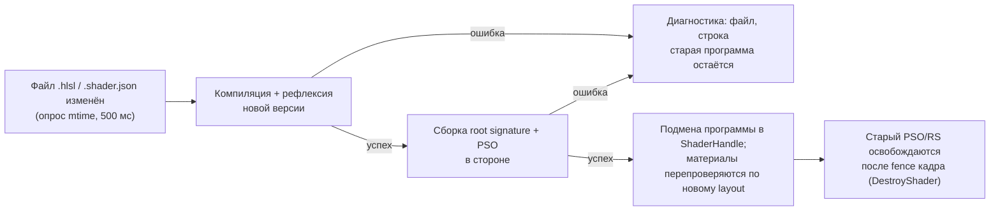
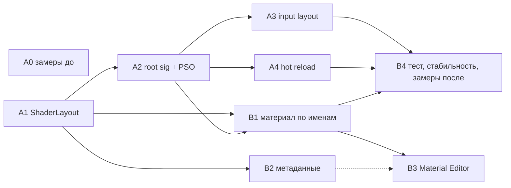

# Рендер: архитектура ЛР3 (рефлексия шейдеров и живые потребители)

Документ написан до кода (правило курса). Источники фактов: `Dx12RenderAdapter.cpp`, `ResourceManager.cpp`, `RenderSystem.cpp`, `assets/shaders/`, `assets/materials/`, `docs/dev/gpu-debugging.md`. Числа и имена функций проверены по `main` (`a2d0670`).

## 1. Цель и выбор варианта

**Цель ЛР3.** Рендер должен перестать быть набором вызовов DX12 с зашитыми в C++ слотами и регистрами. Выбран **вариант Б: рефлексия шейдеров + живые потребители**. Шейдер становится единой точкой правды: ресурсы, константы и входы вершин берутся из скомпилированного HLSL, а не дублируются в C++.

**Почему Б.**
- Шейдеры уже компилируются из HLSL через `D3DCompile` (fxc, SM 5.0), поэтому `D3DReflect` работает на тех же блобах и новых зависимостей не требует (`d3dcompiler` уже линкуется).
- «Двойная правда» есть и сейчас: три root signature и три input layout написаны руками в `Dx12RenderAdapter.cpp` (раздел 2). Это ровно то, что лечит рефлексия.
- Материалы уже данные (`.material.json`, Material Editor, hot reload в `ResourceManager`), поэтому потребитель №2 и допфичи ложатся на готовую основу.

**Почему не остальные.**

| Вариант | Причина отказа |
| --- | --- |
| А. Render graph | В кадре три группы проходов (`Scene`, `Debug Lines`, `UI`) и проходы в render target для превью. ТЗ осмысленно только от 4+ проходов; наращивать пайплайн ради графа — отдельная большая работа |
| В. RHI-слой | Весь DX12 сидит в одном `Dx12RenderAdapter.cpp` (2679 строк) за `IRenderAdapter`. Свой RHI с null-бэкендом означает переписать адаптер целиком; граница «рендер-код не вызывает DX12» уже частично есть, нового мало |
| Г. Материальная система | Материал как данные уже есть (`shader` + `texture` + `tint`, Material Editor, hot reload, fallback). Засчитать как новую работу трудно; нужные куски (параметры по именам) входят в Б |
| Д. Culling + submission | Culling уже есть, но `RenderSystem` каждый кадр строит `Octree` заново (`FrustumCulling`): ТЗ такой stateless-проход не засчитывает. Нужна stateful-подсистема на уровне ECS/сцены и сцена на 10 000 объектов — это работа вне рендера |

**Критерий приёмки (живой).** Преподаватель просит добавить в шейдер константу или текстуру. Root signature, таблицы слотов и порядок биндингов в C++ не правятся. Layout пересобирается рефлексией (потребитель №1), значение подаётся по имени через материал (потребитель №2), результат виден в кадре без перекомпиляции C++.

**Баллы:** наличие и полнота 12, стабильность 6, допфичи до 6 (потолок), своевременность +2 (демо в свой день).

## Список определений

- **Рефлексия** — чтение метаданных скомпилированного шейдера: ресурсы, константные буферы, входы вершинного шейдера.
- **`ShaderLayout`** — наша модель этих метаданных без DX-типов; на ней стоят все потребители.
- **Root signature** — описание того, какие ресурсы шейдер ждёт и в каких слотах; **PSO** — собранное состояние пайплайна (шейдеры, layout, blend/depth/raster).
- **cbuffer** — константный буфер HLSL; **root constants** — константы, записываемые прямо в root signature (сейчас так подаётся `DrawCB`).
- **Потребитель** — код, который строит что-то из `ShaderLayout`: №1 root signature + PSO, №2 материал по именам, №3 input layout.
- **Программа** — пара VS+PS из `.shader.json`, одна запись `ShaderHandle`.

## 2. Как сейчас (по коду)

### Кадр и проходы

`IRenderAdapter` — единственный интерфейс рендера, реализация — `Dx12RenderAdapter`. Группы кадра в RenderDoc/PIX:

```
Frame
  Clear Back Buffer
  Scene          // Draw(...)
  Debug Lines    // DrawDebugLines(...)
  UI             // DrawUiGeometry(...)
  Present Transition
Thumbnail: <файл> / Live view: <id>   // проходы в render target
```

Группы `Scene`, `Debug Lines`, `UI` не объявлены, а выводятся: `EnterAutoGroup` переключает группу, когда вид отрисовки меняется. Барьеры расставлены руками (`ResourceBarrier` в `BeginFrame`, `EndFrame`, `BeginRenderTarget`, `EndRenderTarget`, копировании). Пример статистики кадра `coin_guard_demo` (RelWithDebInfo, кадр 120, из `docs/dev/gpu-debugging.md`): 43 draws, ~16 тыс. треугольников, 3 смены PSO, 14 смен текстур, 2 барьера.

### Шейдеры и ручные root signature

| Программа | HLSL (`assets/shaders/`) | Ресурсы в HLSL | Root signature в C++ | Input layout в C++ |
| --- | --- | --- | --- | --- |
| Сцена | `textured_lit.hlsl` (`VSMain`/`PSMain`) | `cbuffer DrawCB : b0` (4 переменные, 160 байт), `Texture2D t0`, `SamplerState s0` | `BuildRootSignature`: 40 root-констант `b0` + таблица SRV `t0` (PS) + static sampler линейный WRAP | `POSITION` f3, `NORMAL` f3, `TEXCOORD` f2 (в `CreateShaderProgram`) |
| Debug-линии | `debug_line.hlsl` | нет | `BuildDebugLinePipeline`: пустая | `POSITION` f4, `COLOR` f4 |
| UI | `ui_overlay.hlsl` | `cbuffer UiConstants : b0`, `Texture2D t0`, `SamplerState s0` | `BuildUiPipeline`: 4 root-константы (VS) + таблица SRV `t0` + static sampler линейный CLAMP | `POSITION` f2, `COLOR` RGBA8, `TEXCOORD` f2 |

Ещё: wireframe-вариант PSO для сцены (тот же VS, пиксельный шейдер-строка `wireframe_ps`, скомпилированный отдельным `D3DCompile`); `primitive.hlsl` лежит в `assets/shaders/`, но кодом не загружается.

Что C++ знает про шейдер, хотя это написано в HLSL:
- структура `DrawConstants` в `Draw()` (model, viewProjection, color, lightDirection) и число `40` в `SetGraphicsRoot32BitConstants(0, 40, ...)` повторяют `DrawCB`;
- индекс `1` для таблицы текстур и номер регистра `t0`;
- свет сцены зашит константами `(0.35, -1.0, 0.25, 0.25)` в `Draw()`;
- формат и смещения вершин в трёх `D3D12_INPUT_ELEMENT_DESC`.

Итог: чтобы добавить в `textured_lit.hlsl` константу или вторую текстуру, нужно править HLSL, `DrawConstants`, число root-констант, root signature и (для текстуры) таблицу и `Draw()`.

### Компиляция, материалы и hot reload

- `CompileShaderBlob`: читает файл, `D3DCompile` с `D3DCOMPILE_ENABLE_STRICTNESS` (в Debug ещё `DEBUG | SKIP_OPTIMIZATION`). Ошибка пишется в лог одной строкой: путь, entry, профиль, `HRESULT`, текст fxc. Структурированной ошибки (файл, строка) нет, рефлексии нет.
- `.shader.json` (`textured_lit.shader.json`): `source`, `vertexEntry`, `pixelEntry`, `vertexProfile`, `pixelProfile`.
- `.material.json`: только `shader`, `texture`, `tint` (`MaterialAsset`). Материалов в `assets/materials`: `default`, `warm`, `cool`, `gold`, `africanhead` и каталоги `generated/`, `rl/`. Параметров по именам нет.
- Material Editor (`BuildMaterialEditorPanel`) правит те же три поля.
- `DrawItem` = `mesh`, `shader`, `texture`, `model`, `color`.
- Hot reload шейдеров уже есть в `ResourceManager`: `UpdateHotReload` раз в 500 мс сравнивает `last_write_time` у `.shader.json` и `.hlsl` на главном потоке и перезагружает изменённые (`ReloadChangedShaders`). Но:
  - при ошибке компиляции ресурс заменяется общим fallback-шейдером `textured_lit` (`BuildShaderFallback`), а не остаётся прежняя версия;
  - у `IRenderAdapter` нет `DestroyShader`: записи `shaders_` в адаптере удаляются только в `Shutdown`, то есть каждая перезагрузка оставляет старые PSO (утечка GPU-объектов, мешает сценарию «длинная сессия без утечек»).

### Что уже есть для ЛР

Tracy-зоны (`RenderSystem`: `CollectRenderables`, `FrustumCulling`, `BuildDrawItems`, `SubmitDraws`), маркеры проходов, `--frame-stats N`, захват RenderDoc (`F12`, `--renderdoc`, `--gpu-capture-frame N --exit-after-capture`), `tools/gpu/frame_report.py`, DRED (`--dx12-debug`), рендер в текстуру с чтением пикселей (`ReadRenderTargetPixels`, R2). Всё это используется в замерах и тестах.

## 3. Целевая архитектура

### 3.1 Поток



Принцип: **C++ не знает ни регистров, ни смещений, ни числа root-параметров.** Знает только имена (`"gTexture"`, `"gColor"`) и «семантики движка» (раздел 3.5).

### 3.2 Модель `ShaderLayout`

Новый заголовок `engine/include/myengine/render/ShaderLayout.h`, никаких `d3d12.h`/`d3d11shader.h` наружу.

```cpp
namespace myengine::render
{
    enum class ShaderStage : std::uint8_t { Vertex = 1, Pixel = 2 };         // маска

    enum class ShaderResourceType : std::uint8_t { ConstantBuffer, Texture, Sampler, RWResource };

    struct ShaderResource                  // CBV / SRV / Sampler / UAV
    {
        std::string name;                  // "gTexture"
        ShaderResourceType type;
        std::uint32_t registerIndex;       // b0 / t0 / s0 ...
        std::uint32_t space;               // 0 для SM 5.0
        std::uint32_t bindCount;
        std::uint8_t stages;               // маска ShaderStage
    };

    enum class ShaderValueType : std::uint8_t { Float, Float2, Float3, Float4, Float4x4, Int, UInt, Bool };

    struct ShaderVariable                  // переменная cbuffer'а
    {
        std::string name;                  // "gColor"
        ShaderValueType type;
        std::uint32_t offset, size, arrayCount;
    };

    struct ShaderConstantBuffer
    {
        std::string name;                  // "DrawCB"
        std::uint32_t registerIndex, space, sizeBytes;
        std::vector<ShaderVariable> variables;
    };

    struct VertexInput                     // вход VS
    {
        std::string semantic;              // "TEXCOORD"
        std::uint32_t semanticIndex;
        VertexFormat format;               // Float, Float2, Float3, Float4, UInt...: по типу компонентов и маске
    };

    struct ShaderLayout
    {
        std::vector<ShaderResource> resources;
        std::vector<ShaderConstantBuffer> constantBuffers;
        std::vector<VertexInput> vertexInputs;      // в порядке объявления
        // Поиск: FindResource(name), FindVariable(name) -> {cbuffer, variable}
    };
}
```

Layout программы — **объединение VS и PS**. Ресурс с тем же именем и тем же регистром в обеих стадиях объединяется (маска стадий). Одно имя с разными регистрами/размерами, либо один регистр под разные имена — ошибка (`ShaderDiagnostic` «layout conflict»), программа не создаётся.

`space`: в SM 5.0 всегда 0, но поле хранится в модели. Перенос на SM 5.1 (поле `Space` есть у `ID3D12ShaderReflection`) — решение A1 по результату прототипа и не блокирует остальное.

### 3.3 Компиляция и рефлексия

Внутри адаптера (`engine/src/render/dx12/`): `ShaderCompiler` (текущий `CompileShaderBlob`, возвращает блоб или `ShaderDiagnostic`) и `ShaderReflector` (`D3DReflect` на блобах VS и PS → `ShaderLayout`). Для DXBC SM 5.0 `D3DReflect` отдаёт `ID3D11ShaderReflection` (заголовок `d3d11shader.h`; D3D11-устройство не нужно).

- **Ошибки структурированы:** `ShaderDiagnostic { file, line, column, stage, message }`. Строка и колонка разбираются из формата fxc `путь(строка,колонка): error X####: текст`.
- **Кэш:** `ShaderLayout` и блобы на программу один раз; ключ — путь + хеш исходника (с учётом `#include`), entry, профиль. Инвалидация — перезагрузка файла (раздел 3.7).
- **Доступ:** `IRenderAdapter` получает `GetShaderLayout(ShaderHandle)` (константная ссылка или копия) и `DestroyShader(ShaderHandle)`.
- **Отладочный вывод для приёмки:** `--dump-shader-layouts` и пункт Help → Developer → Shader Layouts (таблица ресурсов, cbuffer'ов с offset'ами и входов VS). Это «просто распечатать» не заменяет потребителей, а помогает показать их работу.

### 3.4 Потребитель №1: root signature и PSO из layout

Заменяет `BuildRootSignature`, root-часть `BuildDebugLinePipeline` и `BuildUiPipeline`. Правила построения (детерминированные, без знания шейдера):

| Элемент layout | Что строится |
| --- | --- |
| cbuffer'ы | Root constants, если суммарный размер всех cbuffer'ов программы ≤ 64 DWORD (лимит root signature; сейчас 40 DWORD). Иначе root CBV с данными в кадровом upload-буфере (`AllocateFrameUploadData` в адаптере уже есть) |
| `Texture2D` (SRV) | Descriptor table, по одному диапазону на ресурс, `visibility` по маске стадий из layout |
| `SamplerState` | Static sampler; параметры берутся из `.shader.json` (`"samplers": {"gSampler": "linear_wrap"}`), по умолчанию линейный WRAP. Рефлексия сэмплер-состояния не хранит, поэтому состояние — тоже данные, не C++ |
| Входы VS | Флаг `ALLOW_INPUT_ASSEMBLER_INPUT_LAYOUT` |

Результат — `ProgramBinding`: для каждого имени ресурса — индекс root-параметра и смещение/тип записи. Он нужен потребителю №2: «имя → слот» считается один раз при создании программы, а не на каждый draw.

Root signature кэшируется по «форме» (хеш правил выше), поэтому программы с одинаковой структурой делят одну. PSO по-прежнему на программу и вариант (обычный, wireframe); состояние blend/depth/raster остаётся описанием в C++ (default для сцены, alpha blend для UI). Потребитель №1 обслуживает **все** проходы: сцена, debug-линии, UI, render target (превью, миниатюры), wireframe. После A2 ручных root signature в коде нет.

### 3.5 Потребитель №2: материал по именам

Материал получает параметры по именам, которые существуют в layout:

```json
{
  "shader": "../shaders/textured_lit.shader.json",
  "textures": { "gTexture": "../textures/debug.bmp" },
  "params": { "gColor": [1.0, 0.75, 0.12, 1.0], "gRoughness": 0.4 }
}
```

- Старый формат (`texture`, `tint`) читается как раньше: `texture` — первая текстура шейдера, `tint` — переменная `gColor`. Точное правило — решение B1, согласуется с `core`.
- API: `SetTexture("gTexture", texture)`, `SetFloat("gRoughness", 0.4f)`, `SetFloat4(...)`, `SetMatrix(...)`. Каждый setter проверяет имя и тип по layout; несоответствие — понятная ошибка (имя, ожидаемый тип, список существующих имён), а не тихий пропуск.
- Хранение: у материала теневая копия каждого cbuffer'а (байты по offset'ам из layout) и таблица текстур по имени. `Draw` копирует её в root constants / upload-буфер и ставит дескрипторы по индексам из `ProgramBinding`.
- **Семантики движка.** Переменные, которые заполняет не материал, а рендерер — `gModel`, `gViewProjection`, `gLightDirection` — находятся тоже по имени в layout (фиксированный короткий список имён в C++). Структура `DrawConstants` и число `40` из `Draw()` исчезают; свет перестаёт быть константами в коде (источник — параметры кадра/цели, как сейчас у `SetTargetLighting`). Все остальные переменные берутся из материала.
- Незаданный параметр получает значение по умолчанию (ноль, либо значение из метаданных шейдера, см. B2). Параметр материала, которого нет в новом layout (после правки HLSL), даёт предупреждение один раз и игнорируется.
- `DrawItem` вместо `texture` + `color` ссылается на блок параметров материала.

### 3.6 Потребитель №3: input layout из входов VS

`D3D12_INPUT_ELEMENT_DESC` строятся из `vertexInputs`: семантика и индекс — из шейдера, формат — из типа/маски компонент (float3 → `R32G32B32_FLOAT`). Смещение и формат в потоке вершин шейдер знать не может, поэтому для каждого потока в C++ остаётся маленькая **таблица формата вершин** «семантика → формат, смещение» (меш: `POSITION`, `NORMAL`, `TEXCOORD`; debug-линии; UI). Это данные о буфере, а не о шейдере.

- VS просит семантику, которой нет в потоке (например, `TANGENT`): PSO не создаётся, ошибка «шейдер X требует вход `TANGENT`, меш его не содержит», старая программа живёт.
- В потоке есть лишние атрибуты — игнорируются.
- Допфича: ручных `D3D12_INPUT_ELEMENT_DESC` в коде не остаётся.

### 3.7 Hot reload шейдеров с пересборкой layout

Использует то, что есть, и исправляет две дыры (раздел 2):



- Подмена атомарна: пока новая версия не собрана целиком, рисуется старая. Ошибка **не** заменяет программу fallback-шейдером (сейчас заменяет).
- `DestroyShader` освобождает старые PSO с отсрочкой по fence, как `DestroyTexture` и render target'ы (`RetireResources`).
- После подмены каждый материал на этой программе перепроверяется по новому layout (раздел 3.5).
- Необязательная часть для сквозного правила ЛР1: компиляция и рефлексия в задаче `Streaming`-пула (D3DCompile не требует устройства), создание PSO — на главном потоке.

### 3.8 Ошибки и диагностика

| Ситуация | Что происходит | Где видно |
| --- | --- | --- |
| Синтаксическая ошибка HLSL, нет entry, неверный профиль | Новая версия не принимается, остаётся старая | Лог `Shader error: <файл>(<строка>,<колонка>): <текст>`, счётчик ошибок шейдеров в Statistics, статус в Material Editor |
| Конфликт VS/PS (имя с разными регистрами, регистр под разные имена) | Программа не создаётся | То же, текст «layout conflict: ...» |
| Материал ссылается на несуществующее имя или не тот тип | Материал помечен некорректным, рисуется предупреждающей заглушкой, остальное работает | Лог один раз: материал, имя, ожидалось/получено, список имён шейдера |
| Нет файла текстуры/шейдера у материала | Как выше | Лог: путь |
| Вход VS, которого нет в потоке вершин | PSO не создаётся, старая программа живёт | Лог: шейдер, семантика |
| Потеря устройства | Как сейчас: DRED, код выхода 6 | Лог, `docs/dev/gpu-debugging.md` |

Счётчики «живых» программ, root signature и PSO идут в статистику, чтобы утечки были видны на длинной сессии.

### 3.9 Структура репозитория (ориентир, окончательно — в PR)

```
engine/include/myengine/render/ShaderLayout.h      - модель layout, ShaderDiagnostic
engine/src/render/dx12/ShaderCompiler.{h,cpp}      - D3DCompile -> блоб или ShaderDiagnostic
engine/src/render/dx12/ShaderReflector.{h,cpp}     - D3DReflect -> ShaderLayout, кэш
engine/src/render/dx12/PipelineBuilder.{h,cpp}     - потребители №1 и №3: root signature, input layout, PSO
engine/src/render/MaterialParams.{h,cpp}           - потребитель №2: setter'ы по именам, теневая копия cbuffer'ов
assets/shaders/*.shader.json                       - + "samplers"
assets/materials/*.material.json                   - + "textures", "params"
docs/render/architecture.md                        - этот документ
docs/measurements/lab3/                            - замеры и захваты до/после
```

`IRenderAdapter`: `CreateShaderProgram` остаётся, добавляются `GetShaderLayout` и `DestroyShader`; остальной интерфейс сохраняется, чтобы редактор, миниатюры и превью не переписывать.

## 4. Сценарии стабильности для живого демо

Все сценарии — в Debug (с `--dx12-debug`: validation ловит несоответствие root signature) и в RelWithDebInfo. Ожидание везде: движок жив, ошибка диагностирована (файл, что не сошлось), на экране нет мусора.

| # | Сценарий | Что делаем | Ожидаем |
| --- | --- | --- | --- |
| 1 | Синтаксическая ошибка в HLSL | Убрать `;` в `textured_lit.hlsl`, сохранить | В логе `textured_lit.hlsl(<строка>,<колонка>): error X...`, **сцена рисуется прежним шейдером**. Вернуть `;` — подхватилось |
| 2 | Нет entry или неверный профиль | Переименовать `PSMain` | Ошибка с файлом и именем entry, старая программа живёт |
| 3 | **Серия перезагрузок подряд** | 15–20 сохранений с разными правками (часть с ошибками), F5/пересохранение | Каждый раз новая программа или старая + ошибка; ни одного краша; счётчики PSO/RS не растут |
| 4 | **Живой критерий: новая константа** | Добавить в `DrawCB` (или новый cbuffer) `float gRoughness`, использовать в PS; в материале `"params": {"gRoughness": 0.4}` | Layout пересобран, значение видно в кадре; C++ не пересобирался |
| 5 | **Живой критерий: новая текстура** | Добавить `Texture2D gDetail : register(t1)`, в материале `"textures": {"gDetail": ...}` | Root signature перестроена рефлексией, текстура видна |
| 6 | Переменная исчезла из шейдера | Удалить `gRoughness` из HLSL при существующем `params` | Одно предупреждение «параметр `gRoughness` не найден», остальное рисуется |
| 7 | Материал ссылается на несуществующее имя | `"params": {"gNoSuchName": 1}` | Ошибка с именем и списком имён шейдера, материал не рисуется «мусором» |
| 8 | Не тот тип параметра | `gColor` как число, текст в `float` | Ошибка «ожидалось Float4, получено Float», значение по умолчанию |
| 9 | Рассинхрон слотов | VS и PS объявляют разный ресурс на один регистр, или `gTexture` в `t0` и в `t1` | Ошибка «layout conflict», программа не создаётся, старая жива |
| 10 | Вход VS, которого нет у меша | Добавить в `VSInput` `float3 Tangent : TANGENT` | Ошибка «меш не содержит `TANGENT`», старая программа жива |
| 11 | Файл шейдера удалён или переименован | Переименовать `.hlsl` при работающем движке | Предупреждение, рисуется загруженная версия |
| 12 | Перезагрузка во время превью | Открыть Content Browser с миниатюрами и просмотрщик, пересохранить шейдер | Превью продолжают рисоваться (render target, тот же layout), без падений |
| 13 | **Длинная сессия без утечек** | 10 минут, перезагрузка раз в ~30 с, Play/Stop, ресайз | Число живых программ/RS/PSO в статистике и память GPU (Диспетчер задач) не растут |
| 14 | **Корректный выход** | Закрыть окно во время перезагрузки, с битым шейдером, из Edit и из Play | Без зависания и падения, без сообщений debug layer об утечках живых объектов |

## 5. Замеры

**Методика лекции 2** (как `docs/measurements/lab1/README.md`): сборка `RelWithDebInfo` (Tracy включён только в ней), VSync выключен, окно 1280x720, прогрев (первые секунды отбрасываем), не менее 3 прогонов, медиана и p95/p99, `tracy-capture`. Сцены — `benchmark.json` (массовая) и `rocket_league.json`, фиксированная камера.

| Метрика | Источник |
| --- | --- |
| Frame time | Tracy `Frame` |
| CPU-время рендера | Tracy: `CollectRenderables`, `FrustumCulling`, `BuildDrawItems`, `SubmitDraws`, `Dx12RenderAdapter::Draw` |
| draws, треугольники, смены PSO и текстур, барьеры, GPU ms по проходам | `--frame-stats N` |
| Цена рефлексии на старте и при hot reload | Новые Tracy-зоны (`Shader::Compile`, `Shader::Reflect`, `Shader::BuildPipeline`), добавляются в A1/A2; в «до» их нет, это разовая абсолютная цифра |

**Ожидание.** Ускорения нет и не обещаем: ЛР архитектурная, цену нужно измерить и назвать. Основные риски цены: root CBV вместо root-констант при cbuffer'ах больше 64 DWORD и поиск имён на каждый draw (поэтому «имя → слот» считается один раз в `ProgramBinding`, а не по строке на draw).

**RenderDoc до/после.** `myengine.exe --renderdoc --scene <сцена> --play --gpu-capture-frame N --exit-after-capture`, затем `tools/gpu/frame_report.py` (markdown). Сравниваются дерево маркеров, число draws/PSO/барьеров, root signature в Pipeline State и итоговая картинка кадра: визуальный результат не должен измениться. Захват «до» делает A0 на `main` `a2d0670` до любой правки ЛР3; файлы — в `docs/measurements/lab3/before/`, «после» — в `after/` (крупные `.rdc` не коммитятся, лежат отчёт и путь к захвату).

## 6. План задач

A — Артём, B — Иван (задачи Ивана берутся после мержа A1 и A2: им нужны `ShaderLayout` и потребитель №1 в `main`).

| # | Задача | Кто | Зависит от | Что в баллах |
| --- | --- | --- | --- | --- |
| **A0** | Замеры и RenderDoc «до» (на `main` до правок), фиксируем в `docs/measurements/lab3/before/` | A | — (снимать до мержа A1) | Замеры, обязательно |
| **A1** | `ShaderCompiler` + `ShaderReflector` → `ShaderLayout`, кэш, структурированные ошибки, `GetShaderLayout`, дамп layout'ов, тест `shader_reflection` | A | — | Рефлексия, обязательно |
| **A2** | Потребитель №1: root signature + PSO из layout для сцены, debug, UI, render target, wireframe; удалить ручные root signature | A | A1 | Потребитель №1, обязательно |
| **A3** | Потребитель №3: input layout из входов VS + таблицы формата вершин; удалить ручные `D3D12_INPUT_ELEMENT_DESC` | A | A2 | Допфича, 2 |
| **A4** | Hot reload шейдеров: пересборка layout/RS/PSO, ошибка → старая программа живёт, `DestroyShader`, перепроверка материалов | A | A2 | Допфича, 2 |
| **B1** | Потребитель №2: `params`/`textures` в `.material.json`, `MaterialParams`, диагностика рассинхрона | B | A1, A2 | Потребитель №2, обязательно |
| **B2** | Метаданные в исходнике шейдера (`// @min 0 @max 1 @step 0.01 @label "..."`): парсер комментариев к переменным cbuffer | B | A1 | Допфича, 2 |
| **B3** | Material Editor из рефлексии: виджеты по типу и метаданным, автозаполнение параметров, undo | B | B1 (B2 желательно) | Допфича, 2 |
| **B4** | Рендер-тест оффскрин с эталоном, сценарии стабильности (раздел 4), замеры «после» | B | A2, B1, A3, A4 | Допфича, 2; стабильность |



**Допфичи** (потолок ТЗ — 6 баллов, берём с запасом): A3 — 2, A4 — 2, B2 — 2, B3 — 2, рендер-тест в B4 — 2, разметка RenderDoc + Tracy — 2 (уже есть с QA1, показать живьём). Номинально 12 баллов при потолке 6.

**Риски.**
- `space` и интерфейс рефлексии на SM 5.0: проверяется прототипом в A1 (раздел 3.2), на объём работы не влияет.
- Лимит root signature 64 DWORD: сцена сейчас 40; правило перехода на root CBV описано в 3.4.
- Совместимость материалов: старые `.material.json` (`assets/materials`, `generated/`, `rl/`) должны читаться без правок (раздел 3.5).
- Fallback при ошибке шейдера сейчас скрывает проблему; его замена на «старая версия живёт» входит в A4.

## 7. Работа с гитом

- Базовая ветка лабы — `main` (CLAUDE.md: между лабами базовая ветка `main`). Каждая задача — своя ветка `lab3/<id>-<slug>` от `main` (`lab3/a0-baseline`, `lab3/a1-shader-reflection`, ...) и PR обратно в `main`.
- PR от имени Артёма (для A-задач) и Ивана (для B-задач); без упоминаний Claude и агентов.
- Задачи B начинаются после мержа A1 и A2, чтобы опираться на `ShaderLayout` и потребителя №1 из `main`.
- Перед PR: сборка `Debug` и `RelWithDebInfo` без ошибок и предупреждений, `ctest`, `tools/check.ps1 -Quick` (`-Asan` перед PR); смену архитектуры в ходе работы согласовывать с этим документом — при расхождении побеждает документ, а расхождение обсуждается до кода.
- Документация: `docs/render/` ведётся в ветке `docs/lr3-architecture` (этот документ) и далее по мере задач; отчёт по ЛР — после приёмки.
