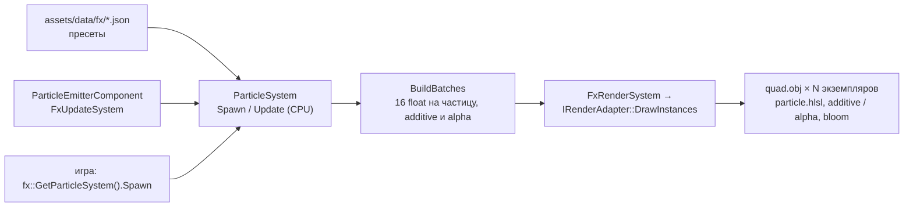

# Частицы (G7c)

CPU-симуляция поверх инстансинга и additive-проходов G7b ([scene-passes.md](scene-passes.md)): эффекты (именованные пресеты эмиттеров) создаются игрой или сценой, `Update` двигает частицы, `BuildBatches` превращает их в данные экземпляров, рендер рисует **один instanced draw на режим смешивания** (additive и alpha). Бюджет — **5000 живых частиц**. Код: `engine/include/myengine/fx/`, `engine/src/fx/`, шейдер `assets/shaders/particle.hlsl`, пресеты `assets/data/fx/*.json`, ассеты `tools/gen_rl_fx.py`. Подключение к игре — задача G7d.

## Как это устроено



- `ParticleSystem` — чистый C++ без рендера и устройства: тесты гоняют его как есть.
- `FxUpdateSystem` (после физики и скриптов) шагает симуляцию и играет компоненты сцены; `FxRenderSystem` (после `RenderSystem`, до отладочных линий) собирает батчи и вызывает `DrawInstances`.
- Глобальный экземпляр: `fx::GetParticleSystem()`. `Application` загружает пресеты из `assets/data/fx` при старте.

## API

```cpp
auto& particles = myengine::fx::GetParticleSystem();

// одноразовый эффект: гол
fx::SpawnParams goal;
goal.position = {x, y, z};  goal.direction = {0, 1, 0};
goal.tint[0] = 0.25f; goal.tint[1] = 0.55f; goal.tint[2] = 1.0f;      // цвет команды (умножает цвет частиц)
particles.Spawn("goal_explosion", goal);

// продолжающийся эффект: буст, держится, пока нажат
fx::EffectId boost = particles.Spawn("boost", params);
particles.SetTransform(boost, exhaustPosition, backwardsDirection, carVelocity);   // каждый кадр
particles.SetRateScale(boost, boostAmount);
particles.Stop(boost);                       // эмиссия прекращается, частицы в воздухе доживают; Stop(boost, true) — убрать сразу

particles.Update(dt);                        // раз в кадр (в сцене это делает FxUpdateSystem)
```

`SpawnParams`: `position`, `direction` (куда «смотрит» эффект: пламя уходит против него, искры вдоль), `velocity` (скорость источника: частицы наследуют долю), `scale` (размеры, расстояния и скорости), `intensity` (яркость и размер всплесков), `tint` (множитель цвета), `rateScale` (частота непрерывной эмиссии). Эффект живёт, пока его эмиттеры работают и в воздухе есть их частицы; `EffectId` — слот и поколение, id умершего эффекта недействителен.

Бюджет: `SetBudget(n)` (5000 по умолчанию); лишние частицы не создаются и считаются в `GetStats().dropped`; у каждого эмиттера есть свой `maxParticles`. Шаг `Update` ограничен 0.1 с (подвисание не взрывает эффекты). Частицы движущегося источника за кадр размазываются по пройденному пути (след без разрывов). `SetSeed` делает симуляцию воспроизводимой.

## Пресет (`assets/data/fx/<имя>.json`)

```json
{ "name": "sparks_hit",
  "emitters": [
    { "name": "sparks", "blend": "additive", "frame": 2, "bursts": [[0, 30]], "maxParticles": 80,
      "shape": "point", "coneAngle": 65, "lifetime": [0.18, 0.5], "speed": [6, 16], "gravity": [0, -9.8, 0], "drag": 1.1,
      "size": [0.18, 0.3], "stretch": 2.2, "stretchSpeed": 0.12, "intensity": 3.0, "useTint": false,
      "color": [[0, [1, 0.95, 0.6, 1]], [0.5, [1, 0.6, 0.2, 0.8]], [1, [1, 0.3, 0.08, 0]]] } ] }
```

| Поле эмиттера | По умолчанию | Что |
| --- | --- | --- |
| `blend` | `additive` | `additive` или `alpha` (alpha-батч сортируется от дальних к ближним) |
| `frame` | 0 | кадр атласа: 0 точка, 1 дым, 2 искра-полоса, 3 кольцо, 4 конфетти, 5 звезда-вспышка |
| `rate`, `bursts` | — | частиц в секунду; и всплески `[время, число]` (число × `intensity`) |
| `loop`, `duration`, `startDelay` | false, 0, 0 | `loop` — до `Stop`; иначе `rate` работает `duration` секунд (0 — только всплески) |
| `shape`, `shapeRadius` | `point`, 0 | `point`, `sphere` (внутри шара, наружу), `disc` (диск ⟂ направлению), `cone` |
| `coneAngle` | 0 | полуугол конуса вокруг направления, градусы |
| `lifetime`, `speed`, `size` | 1, 0, 0.2 | число или `[min, max]` |
| `inheritVelocity` | 0 | доля скорости источника |
| `rotation`, `rotationSpeed` | 0 | градусы, град/с (диапазоны) |
| `gravity`, `drag` | 0 | м/с², 1/с (скорость затухает как `exp(-drag·t)`) |
| `floorY`, `bounce` | выкл | пол: отскок с этим коэффициентом и смерть при втором касании |
| `sizeOverLife` | 1 | ключи `[t, множитель]` |
| `color` | белый | ключи `[t, [r, g, b, a]]`; rgb может быть > 1 (светится и даёт bloom) |
| `intensity` | 1 | множитель rgb (HDR) |
| `stretch`, `stretchSpeed` | 0 | > 0: полоса вдоль скорости, длиннее ширины в `stretch + stretchSpeed·скорость` раз; 0 — лицом к камере |
| `useTint` | true | умножать на `SpawnParams::tint` (цвет команды) |
| `maxParticles` | 200 | живых одновременно от этого эмиттера |

Ошибки разбора (`ParseEffectText`) называют эффект, эмиттер и поле: неизвестный `blend` или `shape`, нет эмиссии, `lifetime` ≤ 0, поле не того типа.

## Пресеты проекта

| Пресет | Когда | Как ставить |
| --- | --- | --- |
| `boost` | пламя, ядро, дым и искры буста | цикл у выхлопа, `direction` — назад (против движения), `SetTransform` каждый кадр, `rateScale` по нажатию |
| `ball_trail` | след мяча на скорости | цикл у мяча, `tint` — команда последнего касания, `rateScale` = скорость / сверхзвук |
| `sparks_hit` | искры удара (мяч, стена) | `direction` — нормаль поверхности, `scale` / `intensity` по силе |
| `goal_explosion` | гол: вспышка, кольца, конфетти команды и золотое, полосы | над воротами, `direction` вверх, `tint` — команда |
| `demolish` | взрыв демолиша: огненный шар, дым, осколки, вспышка, кольцо | в точке машины, `scale` по размеру |
| `landing` | пыль и искры при приземлении | у колёс, `direction` — нормаль, `intensity` по силе |
| `pad_pickup` | подбор пада: кольцо, вспышка, всплеск искр | на паде, `direction` вверх, `scale` ≈ 1.4–1.6 для большого |
| `supersonic` | сверхзвуковой след машины | цикл у машины, `direction` назад, `tint` — команда |
| `stress_5000` | нагрузка для замеров: 5000 живых частиц | только тесты и замеры |

## Рендер

- `IRenderAdapter::DrawInstances(surface, drawItem, instanceData, count)` — батч экземпляров одного меша и материала одним draw'ом (16 float на экземпляр: то, что программа читает как `INSTANCE0..3`). Батч попадает в прозрачный проход вместе с остальными (additive / alpha, глубина читается, не пишется), не отбрасывает тень и участвует в bloom.
- `assets/shaders/particle.hlsl` читает частицу из потока экземпляров вместо матрицы: `INSTANCE0` — центр и размер, `INSTANCE1` — направление скорости и растяжение, `INSTANCE2` — цвет (rgb > 1 светится), `INSTANCE3` — поворот и кадр атласа. Лицо к камере строится из `gCameraRight` / `gCameraUp` (новые переменные движка, заполняет адаптер); полоса разворачивается вдоль скорости лицом к камере.
- Квад `assets/models/fx/quad.obj`, атлас `assets/textures/fx/particles.tga` (6 кадров по 128 px, мипы строит движок), материалы `assets/materials/fx/particles_additive.material.json` и `particles_alpha.material.json` (шейдер `particle`, `gIntensity`, `gAtlasColumns`). Всё делает `python tools/gen_rl_fx.py`.

## Компонент сцены

`ParticleEmitterComponent` (`"ParticleEmitter"` в JSON сцены): `effect`, `playing`, `retriggerInterval` (0 — цикл играет, одноразовый пресет запускается снова после окончания; > 0 — запуск каждые N секунд), `scale`, `intensity`, `rateScale`, `tint`, `direction` (`directionLocal` — +Z сущности с её поворотом), демо движения `orbitRadius` / `orbitSpeedDeg` (сущность идёт по кругу — для следа мяча). Позиция берётся из `Transform`, скорость — по смещению. Эффект, чей компонент исчез (Play остановили и начали заново), останавливается сам.

## Витрина

`assets/scenes/fx_showcase.json` (генерирует `tools/gen_rl_fx.py` из `rl_showcase.json`): арена G7a, перед новой камерой в ряд стоят все эффекты и звуки по кругу — искры удара с ударом мяча, приземление, подбор пада, демолиш, гол с горном и рёвом (синяя команда), мяч с шлейфом по кругу, буст и мотор у машин, сверхзвуковой след, толпа. Запуск: `myengine.exe --scene assets/scenes/fx_showcase.json --play`; кадр в файл — `--screenshot out.tga --screenshot-frame N`. Скриншоты — в отчёте задачи (`.team/tasks/g7c-evidence/`).

## Замеры

Бюджет задачи: 5000 частиц — не больше 0.5 мс CPU и 0.5 мс GPU. Замер на RTX 3050 Laptop, RelWithDebInfo, 1920×1080.

| Что | Результат |
| --- | --- |
| CPU: симуляция 5000 частиц (`Update`) | 0.045 мс (медиана 300 кадров, тест `fx`) |
| CPU: данные экземпляров (`BuildBatches`, 80 КБ) | 0.13 мс |
| GPU: арена `fx_showcase` без эффектов | 0.895 мс за кадр |
| GPU: то же с `stress_5000` (≈ 4960 живых частиц, 9920 треугольников, один draw) | 0.986 мс, из них прозрачный проход 0.056 → 0.101 мс |

Итого частицы стоят около 0.18 мс CPU и 0.05–0.09 мс GPU: запас ×3–10 от лимита. CPU-замер — в тесте `fx` (проверка падает, если 5000 частиц дороже 0.5 мс), GPU-замер — `myengine.exe --scene <сцена> --play --frame-stats 400`, где в сцене один `ParticleEmitter` с `stress_5000`. Зоны Tracy: `Fx::UpdateSystem`, `Fx::Update`, `Fx::BuildBatches`, `Fx::Render`; для звука — `Audio::Update`.

## Подключение к игре (G7d)

| Событие игры | Эффект |
| --- | --- |
| буст нажат | `Spawn("boost")` один раз на машину, `SetTransform` / `SetRateScale` каждый кадр, `Stop` при отпускании |
| мяч быстрее порога | `ball_trail` цикл, `tint` команды, `rateScale` по скорости |
| удар по мячу, машина о стену | `sparks_hit` в точке контакта, `direction` — нормаль |
| гол | `goal_explosion` у ворот забитой стороны, `tint` команды |
| демолиш | `demolish` в точке машины |
| приземление | `landing` у колёс |
| подбор пада | `pad_pickup` на паде |
| сверхзвук | `supersonic` цикл, пока скорость выше порога |

Для рендера ничего подключать не нужно: `FxRenderSystem` уже в `Application`. Частицы не зависят от игры: если игра не создаёт эффекты, система спит (`LiveParticles() == 0` — `Render` сразу выходит).

## Тесты

`fx` (`tests/fx/FxTests.cpp`, без рендера): разбор пресетов и сообщения об ошибках, кривые и градиенты, всплески и жизнь, частота, бюджет и лимит эмиттера, `Stop` / `Stop(kill)` и id, след движущегося источника, интегрирование (гравитация, сопротивление, отскок от пола), данные экземпляров (размер × масштаб, цвет × тон × яркость, кадр, полоса, сортировка alpha), воспроизводимость, все пресеты проекта (появляются, не больше разумного числа, умирают после `Stop`), стоимость 5000 частиц.

## Ограничения

- CPU-симуляция в одном потоке (job system ЛР1 не нужен: 5000 частиц — доли миллисекунды).
- Нет мягких частиц (затухание по глубине) и текстурной анимации: кадр атласа неподвижен.
- Прозрачные (alpha) частицы сортируются внутри батча, но батч целиком сортируется среди остальных прозрачных draw'ов по центру границ.
- Частицы не освещаются и не отбрасывают тень; свечение — только HDR-цвет + bloom G7b.
