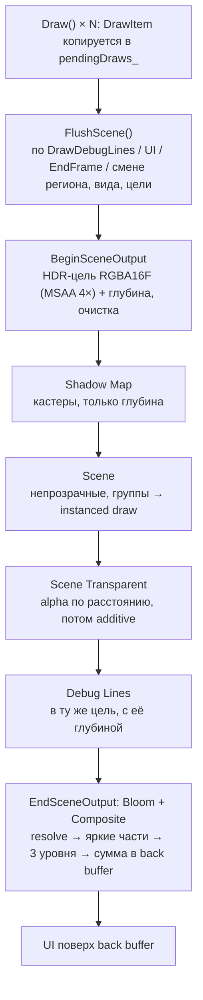

# Проходы сцены: тени, свет, прозрачность, инстансинг, bloom, MSAA (G7b)

Задача G7b игры Rocket League (online): рендер догоняет ассеты G7a ([../game/rl-assets.md](../game/rl-assets.md), раздел «Что нужно от движка»). Всё построено поверх рефлексии шейдеров ЛР3 ([architecture.md](architecture.md)): новые константы, текстуры и входы вершин шейдера находятся по именам, root signature и input layout собираются сами. Код — `engine/src/render/dx12/Dx12ScenePass.cpp`, шейдеры `assets/shaders/lit.hlsl` и `post.hlsl`.

## Что изменилось, коротко

| Возможность | Как включается |
| --- | --- |
| Culling по границам меша (не `0.87 × scale` вокруг начала сущности) | всегда; сфера считается при загрузке меша (`MeshAsset::bounds`) |
| Тени от направленного света: shadow map 2048 / 1024, PCF 3×3 | `RenderSettings::shadowQuality` 0 / 1 / 2; материал `"castShadow": false` выключает отбрасывание |
| Свет лучше Ламберта: блик Блинна-Фонга, френель, полусферический ambient | шейдер `lit.shader.json`; параметры материала `gSpecular`, `gGloss`, `gFresnel` |
| Свечение: emissive и простой bloom | `gEmissiveStrength`, `gEmissiveColor`, `gUnlit`; `RenderSettings::bloom` |
| Прозрачность: alpha-blend (сортировка back-to-front) и additive | материал `"blend": "alpha" | "additive"`, `"doubleSided"`; alpha-test: `gAlphaCutoff` |
| Инстансинг: один меш и материал — один draw | шейдер читает `INSTANCE0..3` (поток `mesh_instanced`); `RenderSettings::instancing` |
| Мип-карты, анизотропия 8×, wrap / clamp, MSAA 4× | мипы строятся при создании текстуры; пресеты сэмплера в `.shader.json`; `RenderSettings::msaaSamples` |

Старые шейдеры (`textured_lit`), миниатюры и превью (render target) и режим wireframe работают так же, как раньше: их draw'ы идут напрямую, без отложенных проходов.

## Кадр



- `Draw()` поверхности больше не пишет команды сразу, а собирает draw'ы; `FlushScene` их сортирует и записывает. Всё, что идёт после сцены (линии, UI), запускает `FlushScene`, UI — ещё и `EndSceneOutput`.
- Вид окна (`SetRenderRegion`, редактор) учитывается: сцена рисуется во вьюпорт региона HDR-цели, composite пишет только этот регион (источник читается по тем же пикселям, `SV_Position`).
- Если MSAA и bloom выключены, HDR-цели нет: сцена идёт сразу в back buffer (RGBA8), но по-прежнему через отложенный список (инстансинг, прозрачность, тени работают).
- Группы маркеров RenderDoc / PIX и проходы `--frame-stats`: `Shadow Map`, `Scene`, `Scene Transparent`, `Bloom`, `Composite`, `Debug Lines`, `UI`. Tracy-зоны: `FlushScene`, `ShadowPass`, `RecordDraws`, `Composite`, `Shader::BuildVariant`, `SceneTargets::Create`.

## Culling по границам меша

`MeshAsset::bounds` (`render::MeshBounds`: центр, полуразмеры, радиус сферы) считается в `ResourceManager` перед загрузкой в GPU. `RenderSystem` берёт центр границ через мировую матрицу и радиус × наибольший масштаб. Меш, который ещё не загружен, получает прежний запасной радиус (или коллайдер). Нормализация мешей под «радиус 0.85» (G7a) больше не нужна, но не мешает: старый `rl_arena.obj` (масштаб 80) и новые меши ведут себя одинаково.

## Тени

- Карта глубины `R32_TYPELESS` (DSV `D32_FLOAT`, SRV `R32_FLOAT`), 2048² (качество 2) или 1024² (качество 1), один каскад.
- Область карты подгоняется под **кастеры** (draw'ы с `castShadow` и `blend = opaque`): в ортографической проекции света точка может быть в тени только под проекцией кастера, поэтому покрывать приёмников не нужно. Размер не больше 240 м; позиция привязана к тексели карты (тень не «ползёт» при движении).
- Приёмник — любая программа, у которой есть текстура `gShadowMap` (движок кладёт туда карту) и константы `gLightViewProjection`, `gShadowParams`. Если приёмников в кадре нет (старые шейдеры), проход теней пропускается.
- Шейдер `lit`: PCF 3×3 аппаратным сравнивающим сэмплером (`shadow_compare`), bias по глубине в `gShadowParams.y`, смещение по нормали (`z`, 1.5 тексели в метрах) и slope-scaled bias в PSO. За пределами карты и на больших глубинах — свет.
- Кастеры в G7a-пакете: машины, колёса, мяч, фары (`castShadow: true`); арена, трибуны, фасад, небо не отбрасывают тени (в `materials.py` у них `castShadow: false`), иначе балки потолка расчертили бы поле.

## Освещение (`lit.hlsl`)

```
lit      = albedo × (hemisphere(N) + sun × N·L × shadow) + sun × spec + sky × fresnel
hemisphere(N) = lerp(ground, sky, N.y × 0.5 + 0.5)
spec     = pow(N·H, gGloss) × gSpecular × N·L × shadow        (Блинн-Фонг)
fresnel  = pow(1 − N·V, 4) × gFresnel                          (кайма цвета неба)
out.rgb  = lerp(lit, albedo, gUnlit) + albedo × gEmissiveStrength + gEmissiveColor
```

Свет сцены (`SceneLighting`): направление, цвет солнца, цвета неба и земли; по умолчанию они дают яркость прежней модели «0.25 + Ламберт». Параметры материала (`.material.json`, `"params"`):

| Параметр | Диапазон | Что делает |
| --- | --- | --- |
| `gSpecular` | 0..4 | сила блика |
| `gGloss` | 1..256 | острота блика |
| `gFresnel` | 0..2 | каёмка по краю |
| `gEmissiveStrength` | 0..16 | текстура ещё раз как свет; выше 1 светится (bloom) |
| `gEmissiveColor` | цвет | добавка собственного цвета свечения |
| `gAlphaCutoff` | 0..1 | > 0: alpha-test (сетка ворот, решётки) |
| `gUnlit` | 0..1 | 1: без освещения (небо, пламя, ореолы) |

Движок сам заполняет по именам (в метаданных шейдера они `@hidden`): `gViewProjection`, `gLightViewProjection`, `gCameraPosition`, `gLightDirection`, `gLightColor`, `gAmbientSky`, `gAmbientGround`, `gShadowParams` (x: 1 / размер карты, y: bias, z: смещение по нормали, w: тени включены). Cbuffer `lit` больше 64 DWORD, поэтому рефлексия сама делает его root CBV (данные в кадровом upload-буфере).

## Прозрачность

Режим берётся из материала (`MaterialAsset::blend`, `DrawItem::blend`), состояние пайплайна — вариант PSO шейдера (создаётся при первом использовании и кэшируется в `ShaderRecord::variants`):

| `blend` | Состояние | Порядок |
| --- | --- | --- |
| `opaque` (по умолчанию) | запись глубины, без смешивания | группы по шейдеру, материалу, мешу |
| `alpha` | `SRC_ALPHA / INV_SRC_ALPHA`, глубина читается, не пишется | от дальних к ближним по центру границ draw'а |
| `additive` | `SRC_ALPHA / ONE`, глубина читается, не пишется | порядок не важен, группируется |

`"doubleSided": true` отключает отсечение задних граней (сетка, пламя, стекло). Alpha-test непрозрачного материала — `gAlphaCutoff` (`clip`). В G7a-пакете: стеклянные панели над рампами и потолок (`arena_glass_*`, alpha), пламя буста и шары падов (additive), сетка ворот (alpha-test, текстура с альфой).

## Инстансинг

- Поток вершин `mesh_instanced` (`.shader.json`: `"vertexStream": "mesh_instanced"`) — меш плюс слот 1: матрица модели из четырёх `float4` (`INSTANCE0..3`, шаг на экземпляр, 64 байта). Шейдер собирает `float4x4(row0..row3)`; `gModel` ему не нужен.
- Подряд идущие после сортировки draw'ы одного меша, программы, материала, текстуры и состояния — один `DrawIndexedInstanced`. Матрицы пишутся в кадровый upload-буфер поверхности. Программы без `INSTANCE` (старый `textured_lit`) рисуются по одному, с `gModel` в константах.
- Через `RenderSettings::instancing` режим выключается (каждый draw отдельно).
- Прямой путь (render target, wireframe) рисует такую программу одним экземпляром.

## Текстуры и сэмплеры

- **Мипы:** при создании текстуры считается полная цепочка (усреднение 2×2 на CPU), SRV с полным числом уровней.
- **Анизотропия 8×:** пресеты `anisotropic_wrap`, `anisotropic_clamp` (раньше было 16, теперь 8).
- **Wrap / clamp** задаёт сэмплер программы (`"samplers": {"gSampler": "anisotropic_clamp"}`): материал выбирает его, выбирая программу — `lit` (wrap), `lit_clamp` (clamp; небо). Пресет `shadow_compare` — сравнивающий сэмплер карты теней (граница = свет).

## MSAA и bloom

- HDR-цель `RGBA16F`, MSAA 4× (или 1), глубина `D32_FLOAT` тех же размеров, создаются под размер поверхности (`SceneTargets`).
- В конце сцены: `ResolveSubresource` в одиночную текстуру; bloom (`post.hlsl`): яркие части выше `bloomThreshold` в половинном разрешении (4 билинейных тапа с мягким порогом на каждом), три уровня (½, ¼, ⅛) вниз коробочным фильтром и вверх тентом с добавлением; composite = сцена + bloom × `bloomIntensity`, запись в back buffer с цветом как раньше (без тонемаппинга).
- Гамма не менялась: текстуры и back buffer остаются в одном пространстве (`R8G8B8A8_UNORM`), как у `textured_lit`.

## Настройки и диагностика

```cpp
RenderSettings s;            // IRenderAdapter::SetRenderSettings(s), между кадрами
s.shadowQuality = 2;         // 0 выкл, 1 низкое (1024, PCF), 2 высокое (2048, PCF 3x3)
s.msaaSamples = 4;           // 1 или 4
s.bloom = true;  s.bloomThreshold = 1.0f;  s.bloomIntensity = 0.55f;
s.instancing = true;
SceneLighting l;             // IRenderAdapter::SetSceneLighting(l): direction, color, skyAmbient, groundAmbient
```

Командная строка (переходит в переменные окружения адаптера):

```
myengine.exe --scene assets/scenes/rl_showcase.json --play
    --render-settings shadows=0,msaa=1,bloom=0,instancing=0      // «как раньше»; ключи: shadows, msaa, bloom, instancing, bloom_threshold, bloom_intensity
    --screenshot out.tga --screenshot-frame 180                   // несжатый TGA 32 бит с back buffer
    --frame-stats 120 --frame-stats-out stats.json                // проходы, draws, треугольники, барьеры, GPU мс
```

## Материал

```json
{
  "shader": "../../shaders/lit.shader.json",
  "texture": "../../textures/rl2/arena_glass_blue.tga",
  "tint": [1, 1, 1, 1],
  "params": { "gSpecular": 1.2, "gGloss": 110, "gFresnel": 1.1 },
  "blend": "alpha",
  "doubleSided": true,
  "castShadow": false
}
```

Ключи `blend`, `doubleSided`, `castShadow` читает и пишет `ResourceManager` (Material Editor их не теряет); значения по умолчанию — `opaque`, `false`, `true`.

## Замеры и проверка

Сцена `assets/scenes/rl_showcase.json` (110 сущностей, ≈ 222 тыс. треугольников), RTX 3050 Laptop, окно 1920×1080 (редактор, вьюпорт 1495×690), RelWithDebInfo, `--frame-stats` на кадрах 200 / 220 / 240, медиана трёх. «До» — те же ассеты G7a со старым `textured_lit` и `shadows=0,msaa=1,bloom=0,instancing=0`; остальные строки — новая сцена и включение возможностей по одной:

| Шаг | draw'ов | треугольников | GPU кадра, мс (медиана 3) | GPU сцены без UI, мс | draw'ы по проходам |
| --- | --- | --- | --- | --- | --- |
| before: textured_lit, direct | 89 | 222394 | 0.31 | 0.20 | Scene 89 |
| lit, no extras | 92 | 222546 | 0.42 | 0.30 | Scene 83, Scene Transparent 9 |
| + instancing | 28 | 222546 | 0.41 | 0.30 | Scene 23, Scene Transparent 5 |
| + shadows (2048, PCF 3x3) | 33 | 228786 | 0.48 | 0.37 | Shadow Map 5, Scene 23, Scene Transparent 5 |
| + MSAA 4x | 34 | 228787 | 1.15 | 0.95 | Shadow Map 5, Scene 23, Scene Transparent 5, Bloom 0, Composite 1 |
| + bloom (all on, the default) | 39 | 228792 | 0.94 | 0.78 | Shadow Map 5, Scene 23, Scene Transparent 5, Bloom 5, Composite 1 |

Draw'ов в сцене 89 → 28 (с проходом теней, bloom и composite — 39; цель карточки ≤ 60), GPU кадра остаётся около одной миллисекунды: бюджет 144 FPS (6.9 мс) не затронут. Скачок на строке «MSAA» — цена HDR-цели `RGBA16F` 4× и ресолва; GPU-таймеры редактора шумят (проход Composite иногда показывает 0.4–1 мс вместо 0.02 мс, это ожидание презента, а не работа шейдера).

Скриншоты до / после (`.team/tasks/g7b-evidence/`, `NN_<вид>_before.png` и `_after.png`): общий вид витрины, игровая камера, машины с тенями, ворота с сеткой и табло, трибуны через стекло, пады и шар. Снимаются так: `--scene <сцена> --play --screenshot out.tga --screenshot-frame 180` (кадр — весь редактор, в доказательствах вырезан вьюпорт).

Проверки:

- тесты без GPU и на GPU: `scene_pass` (новый: границы меша, рефлексия `lit` и `post`, поток `mesh_instanced`, пресеты сэмплеров), прежние `root_signature`, `input_layout`, `shader_reflection`, `shader_hot_reload`, `shader_metadata`, `material_editor_model`, `material_params` (материалы пакета на шейдере `lit` проверяются по его параметрам), `material_render`, `render_stability`, `render_reference` (эталон `textured_lit` не менялся: render target рисуется напрямую), `thumbnail_service`, `gpu_stats`, `render_target_smoke` — все зелёные;
- слой отладки DX12 и GPU-based validation (`--dx12-debug --dx12-gbv`) на витрине, со сменой размера окна и закрытием: ни одного сообщения, «live objects after shutdown: none»; то же с `MYENGINE_DX12_ROOT_CBV=1`.

## Ограничения

- Один каскад теней (кастеры подгоняют карту; поле шире 240 м по кастерам покрывается вокруг центра).
- Нет тонемаппинга и отдельной гаммы; bloom складывается в тех же значениях, что и сцена.
- Wrap / clamp задаётся программой, а не материалом напрямую (два варианта `.shader.json`).
- Прозрачные draw'ы сортируются по центру границ, без пересечений внутри одного меша.
